# Silent Room
## Description
Scenario:
A 17-year-old girl named A left home for unclear reasons. After being unable to
contact her for a while, her family reported the case to the authorities. You
are given an image extracted from A's computer to look for traces that can
identify A's current location.
## Phân tích
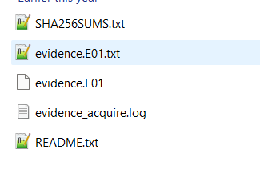
- Challenge cho evidence là 1 tệp .E01 (định dạng disk image tạo bởi công cụ EnCase) kèm 1 vài ghi chú liên quan.
- Sử dụng công cụ FTK imager để mở tệp evidence.E01, ta thấy có 1 phân vùng NTFS (hệ thống mà victim sử dụng là Window) chứa 1 thư mục người dùng là User\A:
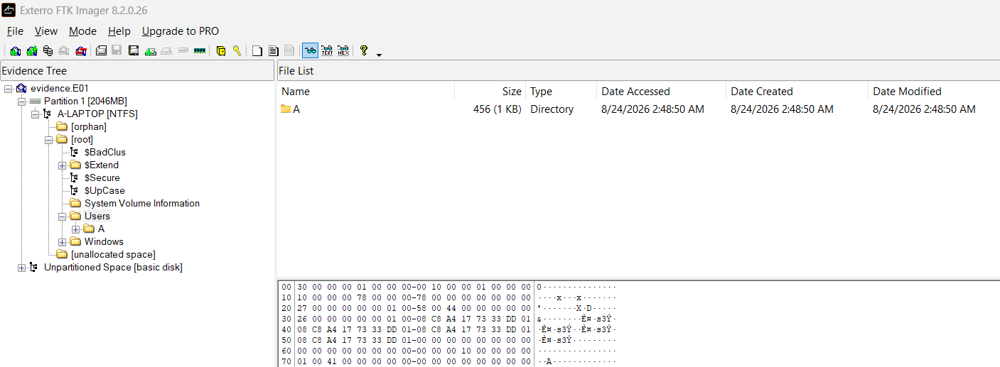
- Kiểm tra thư mục Downloads, ta thấy có 2 tệp ảnh png đã bị xóa, còn lại là 1 tệp .pdf và 1 tệp .html có vẻ như là biên lai:
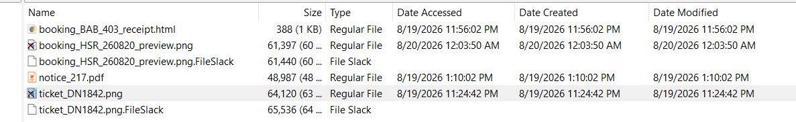
- Tệp notice_217.pdf:
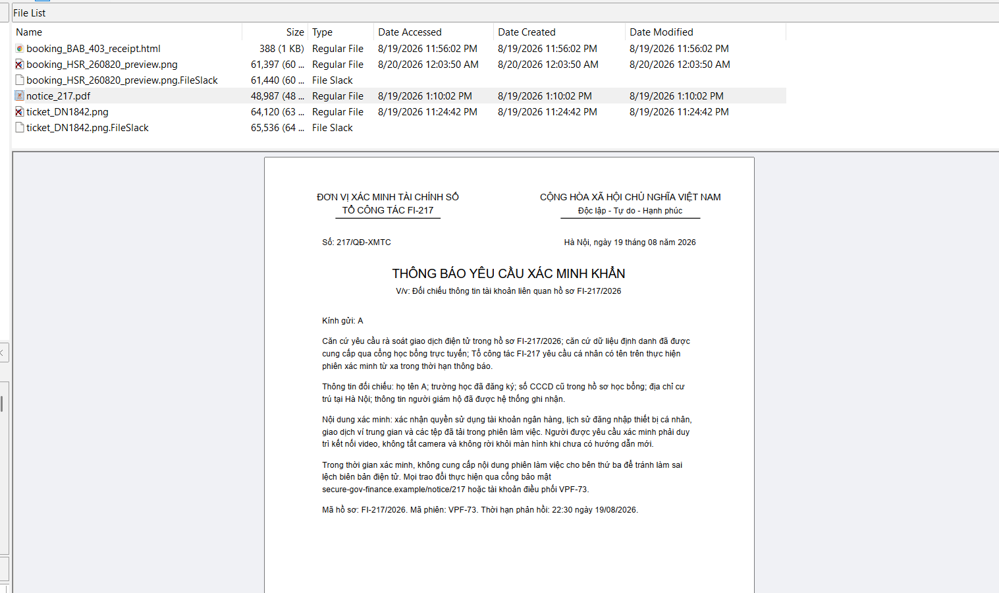
- Từ nội dung, đây là 1 biên bản được gửi đích danh đến nạn nhân yêu cầu nạn nhân xác minh qua video calls sau khi thu thập được thông tin mà nạn nhân nhập vào 1 trang học bổng nào đó. 100% là đào lửa, không có cái cơ quan Việt Nam nào tên là "ĐƠN VỊ XÁC MINH TÀI CHÍNH SỐ" hay "TỔ CÔNG TÁC FI-217", domain trong đây là secure-gov-finance.example trong khi domain thật là .gov.vn. Có vẻ nạn nhận đã dính lừa bởi trang học bổng lừa đảo nào đó và làm theo yêu cầu của bên lừa đảo.
- Tệp .html:
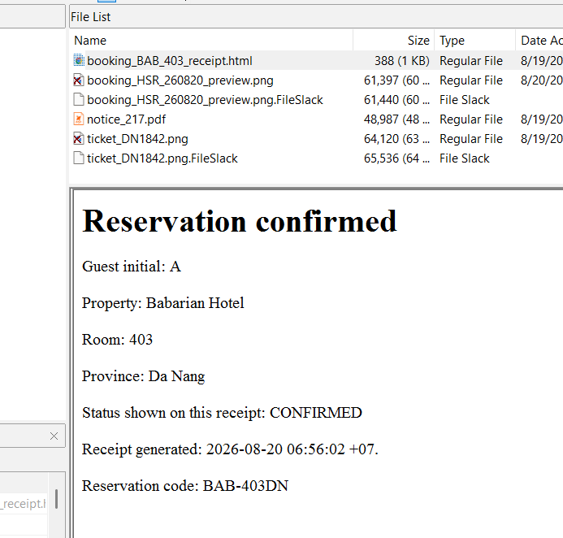
- 1 biên lai chứa thông tin hotel đặt là Babarian Hotel, số phòng 403, TP Đà Nẵng, status đặt phòng đã được confirm và biên lại được tạo ra vào 2026-08-20 06:56:02 UTC+07
- Tiếp theo, ta kiểm tra lịch sử duyệt web của nạn nhân với công cụ DB Browser:
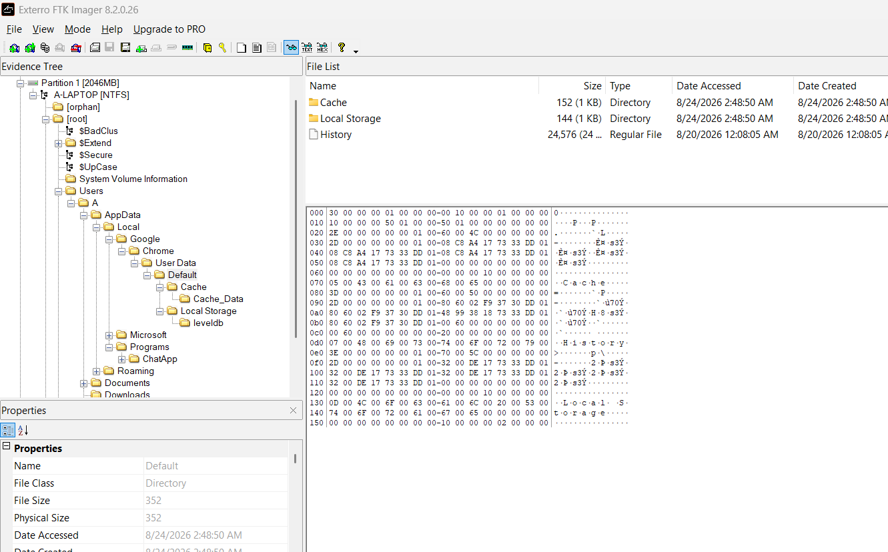
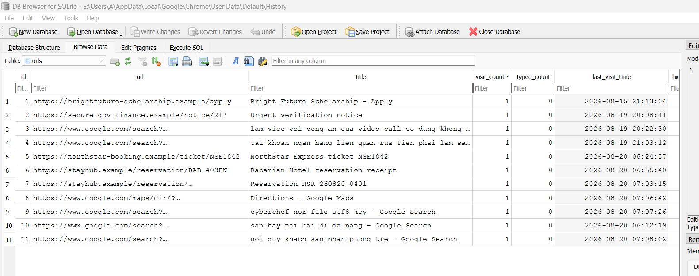
- Nạn nhân đã để lộ thông tin cá nhân qua một trang học bổng giả vào 15/08, 4 ngày sau nhận được “thông báo xác minh khẩn” giả danh cơ quan nhà nước đe dọa liên quan rửa tiền qua video call, sau đó nạn nhân có tra cứu khoản ngân hàng liên quan rửa tiền thì sẽ gặp vấn đề gì, vài giờ sau đó (sáng 20/08) đặt vé máy bay và khách sạn đi Đà Nẵng. Tuy nhiên, ta thấy nạn nhân search "cyberchef xor file utf8 key" với mục đích chưa rõ.
- Table Downloads cho ta biết các tệp đã tải về tương ứng với 4 tệp trong thư mục Downloads lúc trước:
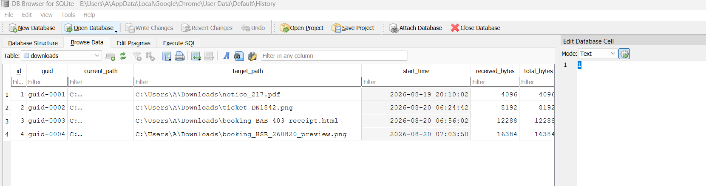
- Trong thư mục Programs, phát hiện 1 thư mục ứng dụng tên là ChatApp, trong thư mục Resources của app chứa 1 tệp là app.bundle.js:
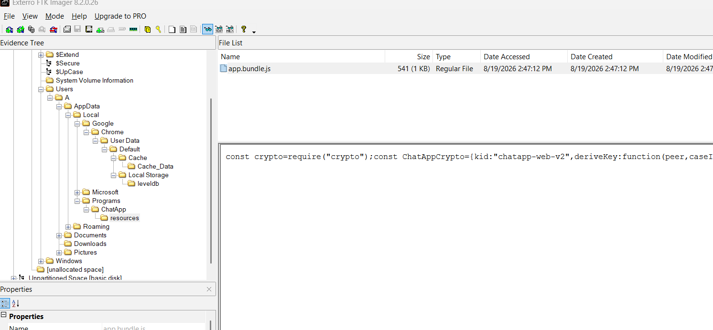
- app.bundle.js:
```javascript
const crypto=require("crypto");
const ChatAppCrypto={
    kid:"chatapp-web-v2",
    deriveKey: function(peer, caseId)
        {
            return crypto.createHash("sha256").update(
                [
                    this.kid,
                    peer,
                    caseId
                ].join("|"),"utf8").digest()
        },
    decryptBody: function(body, peer, caseId)
        {
            const m=JSON.parse(body);
            if(m.alg!=="AES-256-CBC")
                throw new Error("unsupported");
            const d=crypto.createDecipheriv(
                "aes-256-cbc",
                this.deriveKey(peer, caseId),
                Buffer.from(m.iv,"base64")
            );
            return Buffer.concat(
                [
                    d.update(Buffer.from(m.ct,"base64")),
                    d.final()
                ]
            ).toString("utf8")
        }
};
module.exports=ChatAppCrypto;
```
- Tệp js này chứa logic derive key và decrypt dữ liệu của app:
    + Key: sha256("chatapp-web-v2" | peer | caseId)
    + Hàm decryptBody nhận vào 1 cấu trúc JSON, parse lấy ciphertext và iv được encode base64, decrypt sử dụng key trên
- Thư mục AppData\Roaming chứa data của app:
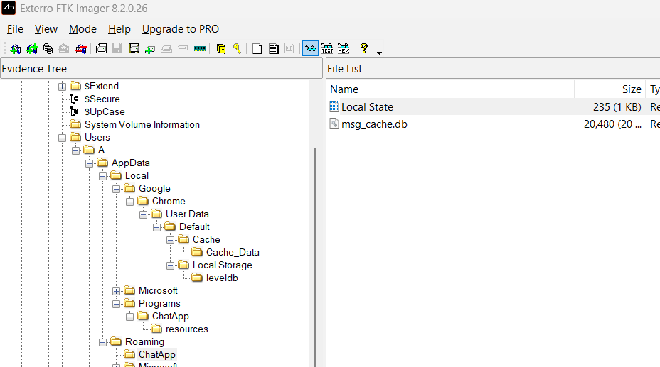

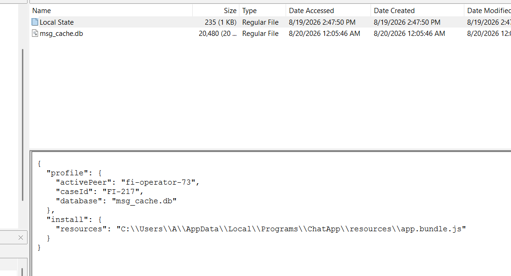
- Tệp Local State chứa config của app cho ta biết tên user sử dụng app là fi-operator-73, id case là FI-217, database chứa app message là msg_cache.db, trường resources chứa path tới tệp js trên.
- Mở msg_cache.db bằng DB browser:
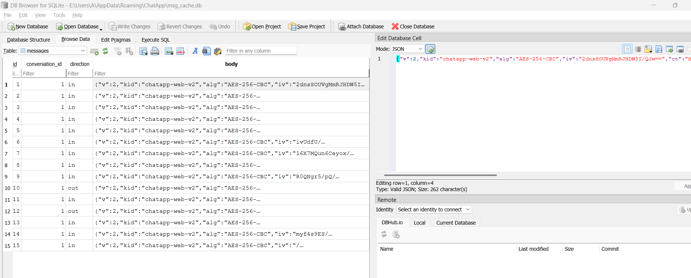
- Mỗi message ghi nhận trong app được lưu trong 1 cấu trúc json chứa thuật toán mã hóa được sử dụng, IV và ciphertext.
- script decrypt:
```python
#!/usr/bin/python3
from Crypto.Cipher import AES
import sqlite3
import json
import base64
import hashlib

key = hashlib.sha256("chatapp-web-v2|fi-operator-73|FI-217".encode('utf8')).digest()

conn = sqlite3.connect('msg_cache.db')
cur = conn.cursor()
res = cur.execute("SELECT body FROM messages")
for body in res.fetchall():
    body = json.loads(body[0])
    iv, ct = base64.b64decode(body['iv']), base64.b64decode(body['ct'])
    
    cipher = AES.new(key, AES.MODE_CBC, iv)
    print(cipher.decrypt(ct).decode('utf8').strip())
```
- Kết quả:
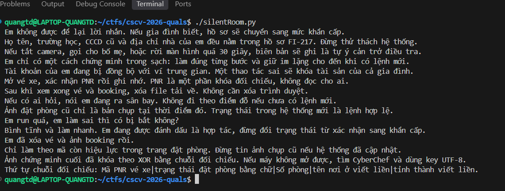
- Bên lừa đảo dọa cấm nạn nhân bóa gia đình, yêu cầu A làm theo chỉ dẫn: ghi nhớ mã PNR vé xe, xóa file tải về, tạo 1 chuỗi đối chiếu xor decrypt ảnh chứng minh.
- Ta cần dùng key = "Mã PNR vé xe|trạng thái đặt phòng bằng chữ|Số phòng|tên nơi ở viết liền|tỉnh thành viết liền" để decrypt một ảnh chứng minh.
- Các tệp ảnh đã bị xóa khi tải về, ta sẽ kiểm tra google chrome cache:
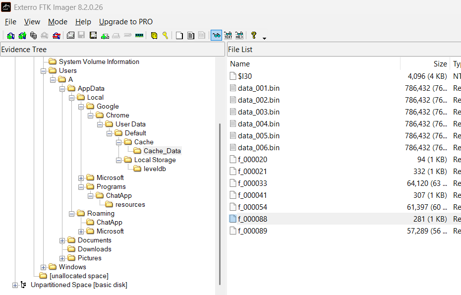
- Tệp f_000088 chứa thông tin tệp cần decrypt là f_000089:
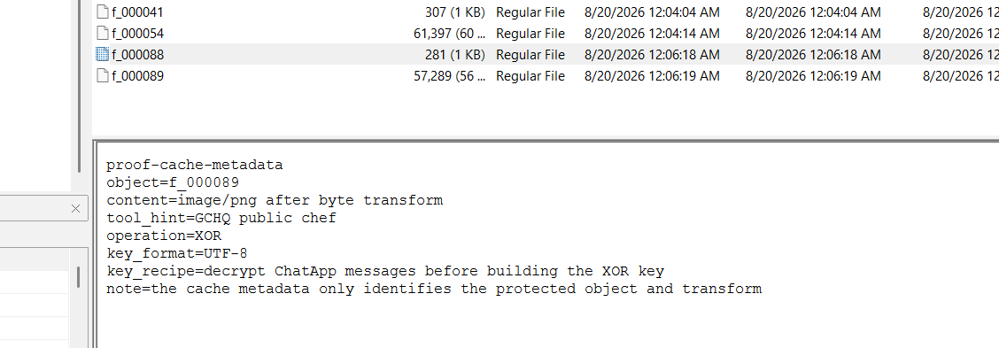
- Tệp f_00020 cho ta biết các trạng thái đặt phòng tương ứng với số, tệp f_000021 cho biết phòng số 403 được đặt đã cập nhật trạng thái từ CONFIRMED (previousState = 2) sang CANCELLED (state = 7) vào thời điểm 2026-08-20T06:58:09+07:00, trường 'supersededBy' cho biết đơn đặt này được thay thế bằng đơn đặt phòng có mã = HSR-260820-0401. Đơn đặt này tương ứng với biên lai phát hiện trong thư mục Downloads:
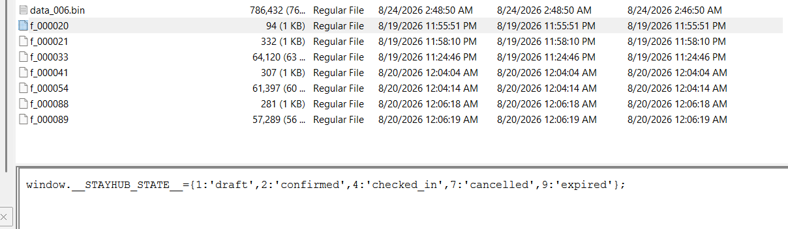

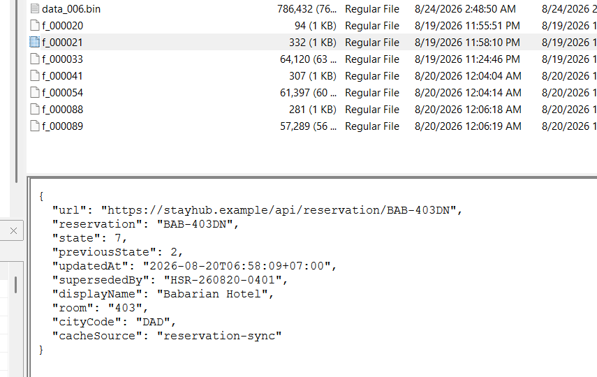
- Tệp f_000041 cho biết thông tin đặt phòng đã cập nhật (phòng số 401, trạng thái là confirmed):
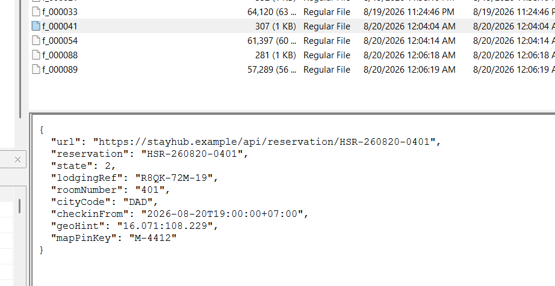
- Tệp f_000033 là vé xe cho biết mã PNR = NSE1842:
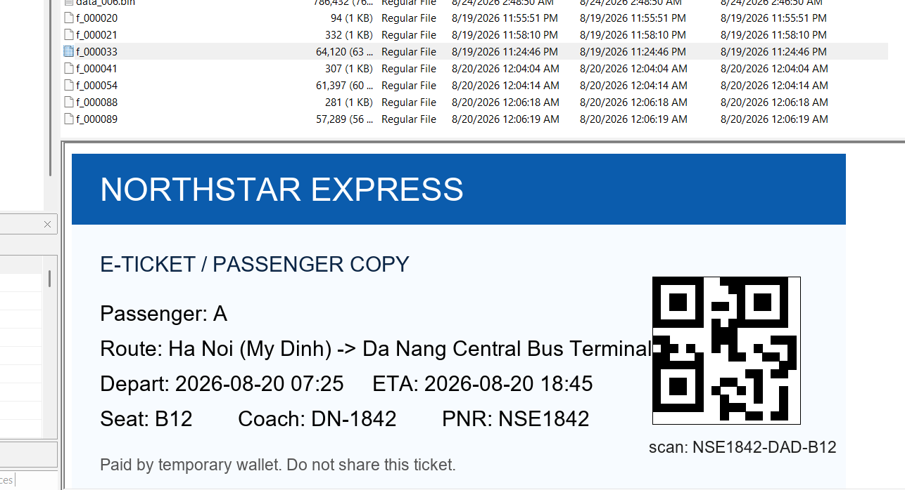
- Tệp f_000054 cho biết thông tin nơi ở hiện tại, mã đặt trong ảnh tương ứng với đơn đặt phòng mới nhất phía trên:
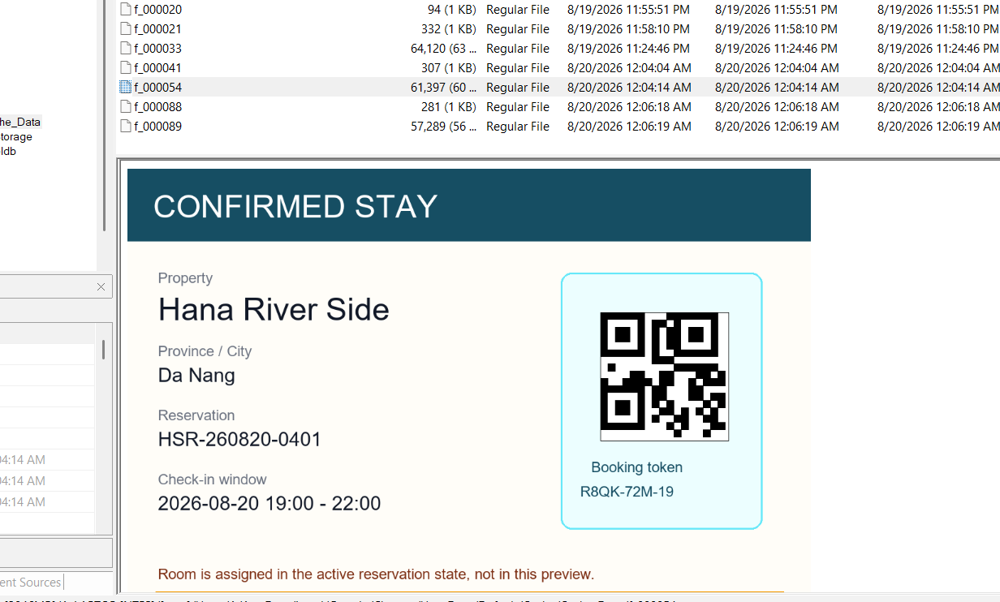
- Từ các thông có được phía trên, key xor = NSE1842|confirmed|401|HanaRiverSide|DaNang
- Flag:
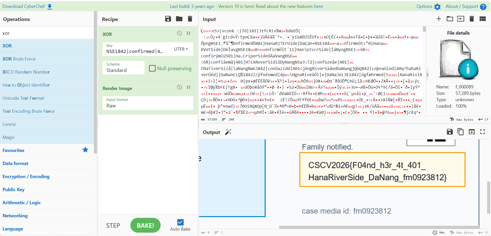