# from update to encrypt
## Description
Ring... tuttt... tuttt....

SOC: Moshi moshi, Is that you, Vu?

VuVT: Holy moly, I've just been running some kind of update, and now my device has been encrypted.

SOC: Do not touch your keyboard. We'll come and investigate.

Then a data sample was collected from the incident.

Investigate to figure out what happened and find the information to restore the final results.
## Phân tích

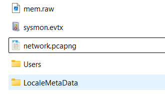
- Challenge cho evidences bao gồm memory dump, log sysmon, thư mục Users của victim và 1 tệp pcapng ghi lại hoạt động mạng.
- Trước tiên, kiểm tra log sysmon để xem user đã thực thi chương trình nào


- Vào khoảng 2026-08-24 09:57:25, các sự kiện cho thấy user mở Notepad cùng một số tệp trong `C:\Users\Public\MetaData\Data`, trong đó có `flag.txt`, `1337dakl.txt` và `ptit.txt`.

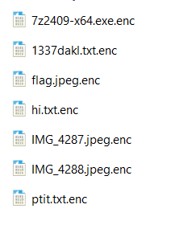
- Vào kiểm tra thư mục `C:\Users\Public\MetaData\Data` cho thấy các tệp đã bị mã hóa và đổi tên với phần mở rộng `.enc`:


- Các tệp này đều bị mã hóa bởi program C:\Users\bkav\Downloads\UpdateX7A91C\update.exe vào 2026-08-25 04:35:06

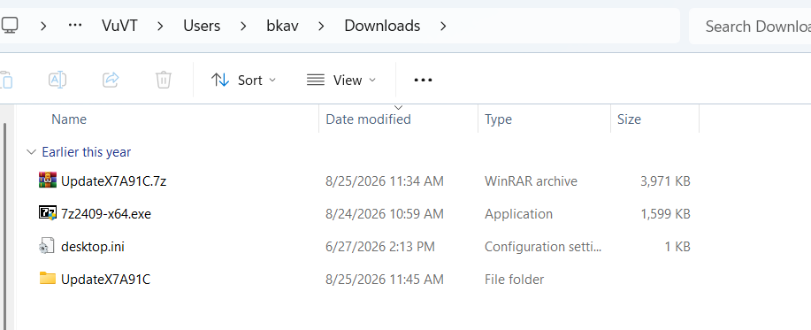


- Thư mục Downloads của victim chứa 1 tệp nén UpdateX7A91C.7z. Sau khi giải nén, thư mục `UpdateX7A91C` chứa `update.exe`, cùng với một số tệp thực thi khác. Tệp update.exe được tạo ra vào 25/8 cùng ngày với thời điểm các tệp trên bị mã hóa trong khi các tệp còn lại được tạo ra vào 12/8.
- Ta sẽ phân tích tệp update.exe này để biết cách decrypt

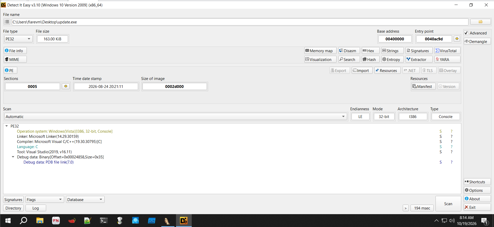
- Detect It Easy xác định `update.exe` là tệp PE32, kiến trúc 32-bit, được biên dịch bằng Microsoft Visual C/C++.

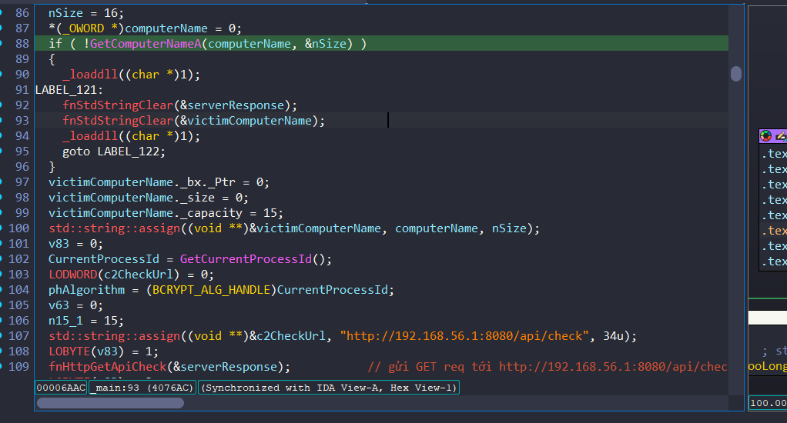
- Trong hàm `_main`, chương trình lấy tên máy tính và PID của tiến trình hiện tại, sau đó gửi HTTP GET đến `http://192.168.56.1:8080/api/check` thông qua `fnHttpGetApiCheck`.

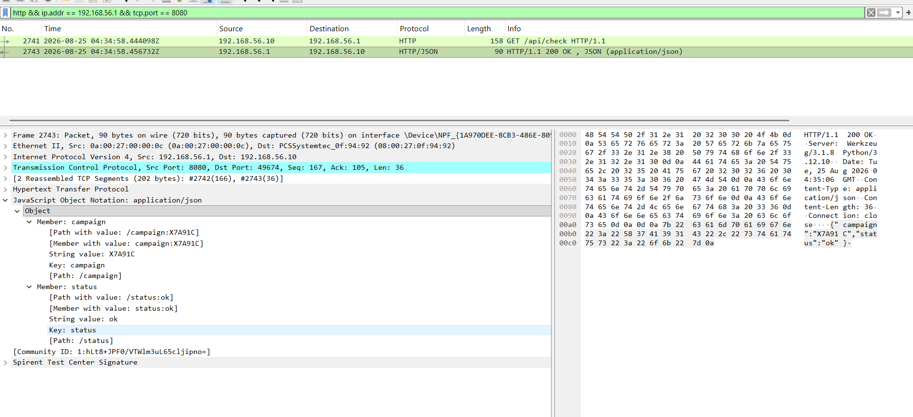
- Phân tích tệp pcapng cho ta biết server phản hồi với nội dung:
```json
{"campaign":"X7A91C","status":"ok"}
```


- Sau khi nhận response từ server, malware gọi hàm fnParseJsonGetCampaignVal để parse data json trên lấy giá trị của trường 'campaign'.

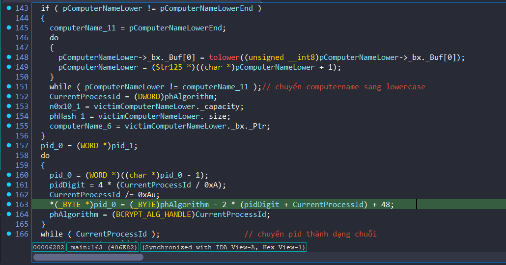
- Malware chuyển tên máy tính sang chữ thường và chuyển PID thành chuỗi.

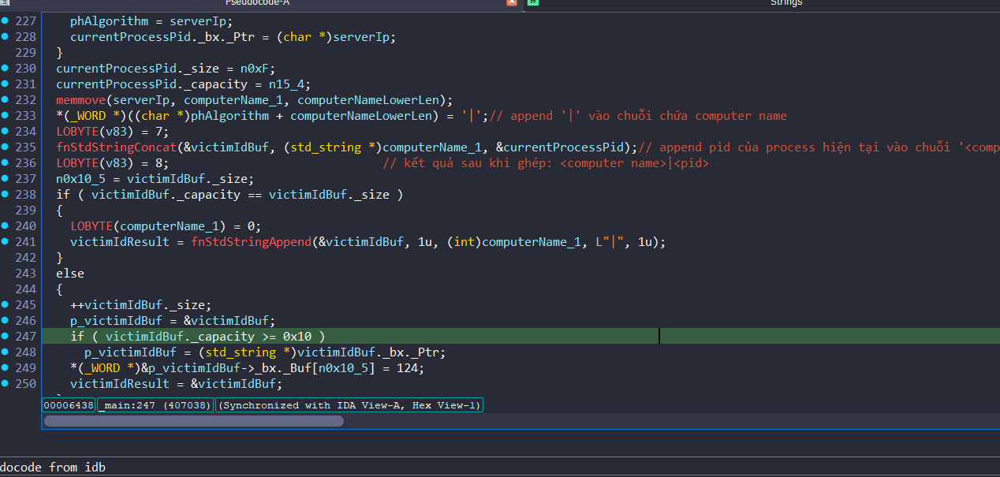

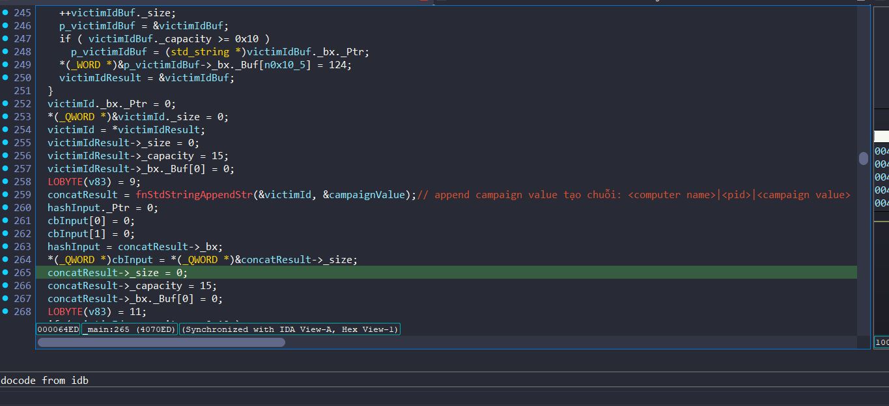
- Tiếp đó, malware ghép tên máy tính, PID và giá trị `campaign` theo định dạng:
```text
<computer name>|<pid>|<campaign>
```
Với dữ liệu của nạn nhân, chuỗi này sẽ là:
```text
desktop-7nnknik|2844|X7A91C
```
- Tên máy tính lấy trong Sysmon; PID có thể xác định từ memory dump hoặc log Sysmon.


- Sau đó, malware tính sha256 hash của chuỗi định danh này. 


- Từ dòng 366 -> 370, malware gọi hàm fnGetMetaDataPath, hàm này gán địa chỉ của chuỗi "C:\\Users\\Public\\MetaData\\Data" cho con trỏ được truyền vào. Tiếp theo, hàm fnEncryptDirectory được gọi với tham số thứ nhất là path này và sha256(<computer name\>|<pid\>|<campaign value\>), hàm này encrypt toàn bộ tệp trong thư mục với key là kết quả sha256 hash vừa tạo


- Trong hàm fnEncryptDirectory, malware trước tiên lấy path tới thư mục "C:\\Users\\Public\\MetaData\\Data", chuẩn hóa đường dẫn được truyền vào và thư mục vừa lấy, sau đó thực hiện kiểm tra các điều kiện:
  - Đường đẫn thư mục truyền vào có đúng là Public\\MetaData\\Data không
  - Đường đẫn thư mục truyền vào có chứa phần mở rộng hay không
  - Kiểm tra xem có phải là thư mục không. 
- Nếu không thỏa mãn cả 3 điều kiện thì throw 1 error


- Sau khi kiểm tra, malware tạo một `std::filesystem::directory_entry` để duyệt các mục trong thư mục đích.
```cpp
 if ( dirEntry )
  {
    do
    {
      if ( fnDirectoryEntryIsRegularFile(dirEntry) )// lọc bỏ qua folder
      {
        fnWstringCopy(entryPath, dirEntry + 8);
        LOBYTE(metaDataPath) = 0;
        LOBYTE(v44) = 8;
        fnGetEncryptedExtension(&encMarker, (UINT)metaDataPath);
        LOBYTE(v44) = 9;
        targetFileExtension = fnFilePathGetExtension((unsigned __int16 *)entryPath, entryFileExt);
        n8_2 = encMarker._capacity;
        targetFileExtension_1 = targetFileExtension;
        Ptr = encMarker._Ptr;
        extensionToCheck = &encMarker;
        if ( encMarker._capacity >= 8 )
          extensionToCheck = (std_wstring *)encMarker._Ptr;// ktra tệp có extention .enc
        isEndWithEnc = (int (__thiscall ***)(void *, char))fnPathCompare(
                                                             targetFileExtension_1,
                                                             extensionToCheck->_Bx,
                                                             encMarker._size);
        if ( entryFileExt_cap >= 8 )
        {
          v12 = entryFileExt[0];
          if ( 2 * entryFileExt_cap + 2 >= 0x1000 )
          {
            v12 = (void *)*((_DWORD *)entryFileExt[0] - 1);
            if ( (unsigned int)((char *)entryFileExt[0] - (char *)v12 - 4) > 0x1F )
              goto LABEL_78;
          }
          fnFreeMemory(v12);
          n8_2 = encMarker._capacity;
          Ptr = encMarker._Ptr;
        }
        entryFileExt[4] = 0;
        entryFileExt_cap = 7;
        LOWORD(entryFileExt[0]) = 0;
        LOBYTE(v44) = 8;
        if ( n8_2 >= 8 )
        {
          Ptr_1 = Ptr;
          if ( 2 * n8_2 + 2 >= 0x1000 )
          {
            Ptr = (wchar_t *)*((_DWORD *)Ptr - 1);
            if ( (unsigned int)((char *)Ptr_1 - (char *)Ptr - 4) > 0x1F )
              goto LABEL_78;
          }
          fnFreeMemory(Ptr);
        }
        if ( isEndWithEnc )                     // nếu tệp ko có extension .enc, đẩy path vào 1 danh sách chứa tệp cần encrypt
        {
          if ( collectedFilesList._Mylast == collectedFilesList._Myend )
          {
            fnCollectedFilesVecInsert((int *)&collectedFilesList, (int)collectedFilesList._Mylast, entryPath);
          }
          else
          {
            fnWstringCopy((_DWORD *)collectedFilesList._Mylast, entryPath);
            collectedFilesList._Mylast = (char *)collectedFilesList._Mylast + 24;
          }
        }
        LOBYTE(v44) = 7;
        if ( entryPath_cap >= 8 )
        {
          v14 = entryPath[0];
          if ( 2 * entryPath_cap + 2 >= 0x1000 )
          {
            v14 = (void *)*((_DWORD *)entryPath[0] - 1);
            if ( (unsigned int)((char *)entryPath[0] - (char *)v14 - 4) > 0x1F )
              goto LABEL_78;
          }
          fnFreeMemory(v14);
        }
      }
      fnDirectoryIteratorIncrement((int *)&dirIterState); // tăng iterator trỏ tới entry tiếp theo
      dirEntry = (_DWORD *)dirIterState;
    }
    while ( (_DWORD)dirIterState ); // lặp cho tới khi duyệt hết tệp tron thư mục
    dirIterRefcount_2 = (volatile signed __int32 *)HIDWORD(dirIterState);
  }
```
- Trong quá trình duyệt, malware bỏ qua thư mục con và các tệp đã có phần mở rộng `.enc`. Những tệp còn lại được thêm vào danh sách `collectedFilesList` để mã hóa.

```cpp
fileToEncrypt = (std_wstring *)collectedFilesList._Myfirst;
  pFileEntryEnd = (std_wstring *)collectedFilesList._Mylast;
  if ( collectedFilesList._Myfirst != collectedFilesList._Mylast )
  {
    do
    {
      if ( !fnEncryptFile(fileToEncrypt, aesKey_1) )
      {
        fnPathToMultiByte(fileToEncrypt->_Bx, (LPSTR)entryFileExt, fnvBasisHi);
        pErrMsgBuf = entryFileExt;
        if ( entryFileExt_cap >= 0x10 )
          pErrMsgBuf = (void **)entryFileExt[0];
        stderrStream = __acrt_iob_func(2u);
        fnfprintf(stderrStream, "[-] Failed to encrypt: %s\n", (const char *)pErrMsgBuf);
        if ( entryFileExt_cap >= 0x10 )
        {
          v20 = entryFileExt[0];
          if ( entryFileExt_cap + 1 >= 0x1000 )
          {
            v20 = (void *)*((_DWORD *)entryFileExt[0] - 1);
            if ( (unsigned int)((char *)entryFileExt[0] - (char *)v20 - 4) > 0x1F )
              goto LABEL_78;
          }
          fnFreeMemory(v20);
        }
      }
      ++fileToEncrypt;
    }
    while ( fileToEncrypt != pFileEntryEnd );
    pFileEntryEnd = (std_wstring *)collectedFilesList._Mylast;
    fileToEncrypt = (std_wstring *)collectedFilesList._Myfirst;
  }
```
- Sau khi hoàn tất việc thu thập, malware duyệt danh sách và gọi `fnEncryptFile` cho từng đường dẫn
- Hàm fnEncryptFile:


- Trước tiên, malware tạo 1 nonce ngẫu nhiên dài 12 bytes bằng BCryptGenRandom, copy đường dẫn truyền vào sang 1 buffer mới rồi nối thêm đuôi `.enc` vào buffer.


- Gọi hàm fnAesGcmEncryptFile để encrypt tệp với tham số lần lượt là: đường dẫn tới tệp cần encrypt, tệp đầu ra chứa ciphertext, key và nonce. Hàm fnAesGcmEncryptFile:


- Trong `fnAesGcmEncryptFile`, malware mở tệp cần encrypt bằng `CreateFileW`.

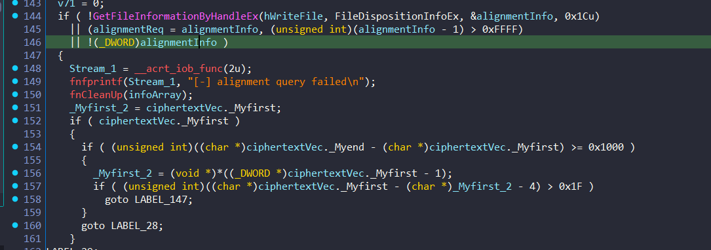


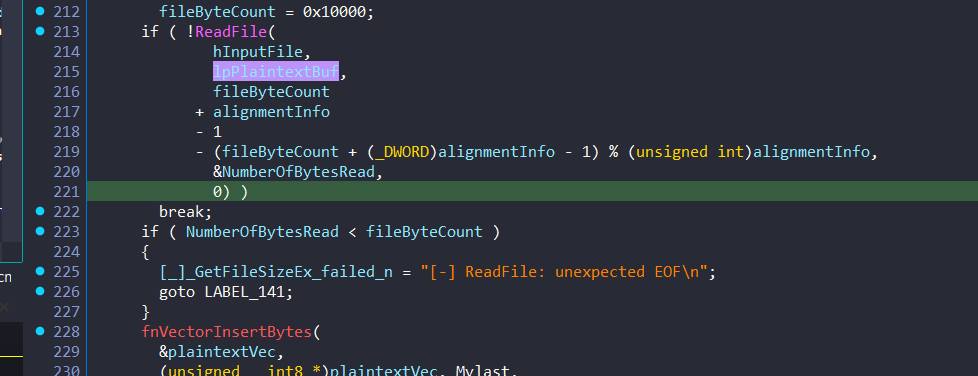
- Kiểm tra một số thông tin của tệp trước khi gọi VirtualAlloc cấp phát 1 buffer chứa plaintext và đọc nội dung tệp vào buffer này bằng `ReadFile`.

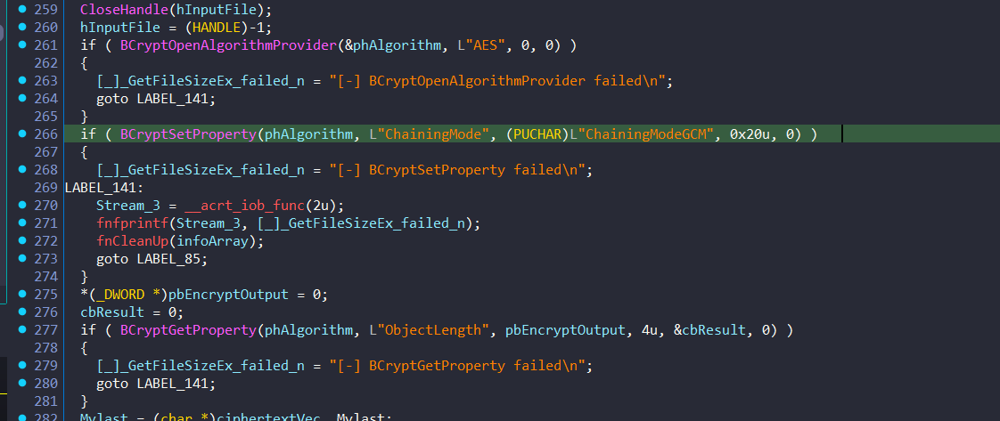
- Khởi tạo AES-GCM thông qua Windows CNG (BCrypt API) và lấy kích thước bộ nhớ cần thiết cho đối tượng khóa.


- Tạo symmetric key AES từ khóa có sẵn (pbAesKey_1) bằng Windows CNG API.

```cpp
 LOBYTE(v85) = 4;
  pPaddingInfo.pbNonce = nonceCopy;
  pPaddingInfo.pbTag = gcmTag;
  cbCipherOut = pbEncryptOut - pbCipherOut;
  *(_QWORD *)&pPaddingInfo.pbAuthData = 0; // aad = ""
  memset(&pPaddingInfo.pbMacContext, 0, 16);
  if ( pbCipherOut == pbEncryptOut )
    pbCipherOut = 0;
  memset(&pPaddingInfo.cbData, 0, 16);
  nonceCopy = pbCipherOut;
  pbPlaintextInput = (char *)((char *)plaintextVec._Mylast - (char *)pbEncryptInput);
  if ( pbEncryptInput == plaintextVec._Mylast )
    pbEncryptInput = 0;
  pPaddingInfo.cbSize = 64;
  pPaddingInfo.dwInfoVersion = 1;
  pPaddingInfo.cbNonce = 12;
  pPaddingInfo.cbTag = 16;
  cbKeyObjectLen = 0;
  ntEncryptStatus = BCryptEncrypt(
                      phKey,
                      pbEncryptInput,
                      (ULONG)pbPlaintextInput,
                      &pPaddingInfo,
                      0,
                      0,
                      pbCipherOut,
                      cbCipherOut,
                      &cbKeyObjectLen,
                      0);
  if ( ntEncryptStatus )
  {
    ntEncryptStatus_1 = ntEncryptStatus;
    Stream_4 = __acrt_iob_func(2u);
    fnfprintf(Stream_4, "[-] BCryptEncrypt failed | status=0x%lx\n", ntEncryptStatus_1);
    fnCleanUp(infoArray);
    _Myfirst_6 = ciphertextVec_1._Myfirst;
    if ( ciphertextVec_1._Myfirst )
    {
```
- Dữ liệu được mã hóa bằng `BCryptEncrypt`. Tham số xác thực bổ sung (AAD) để trống; nonce dài 12 byte và authentication tag dài 16 byte.

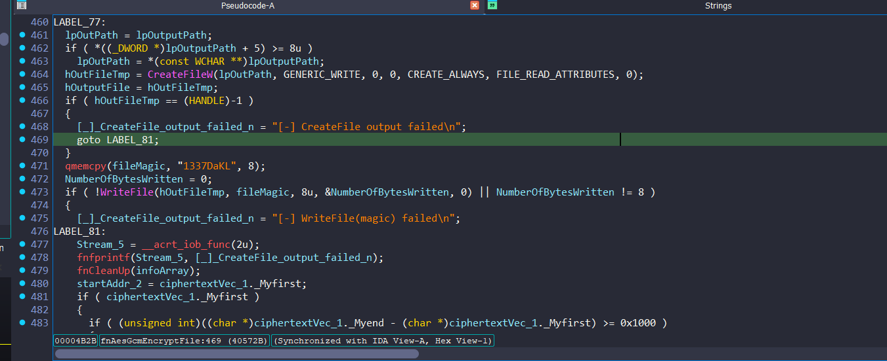
- Sau khi encrypt dữ liệu, malware gọi CreateFileW mở 1 handle tới tệp đầu ra (tham số thứ 2) để ghi, gọi WriteFile ghi vào đâu tệp magic bytes là `1337DaKL`


- Malware tiếp tục ghi 16 bytes đóng vai trò là placeholder chứa tag, ghi vào tệp ciphertext rồi di chuyển con trỏ tệp đến đầu placeholder rồi mới ghi đè tag vào
- Do nonce không được lưu trong tệp đầu ra, cần recover nonce trước khi decrypt. Với AES-GCM, tag được tạo ra như sau:
```
Pre-counter block: J0 = nonce || 0^31 || 1
Hash subkey: H = E_K(0^128)
Tính GHASH: S = GHASH(H, aad, ciphertext)
Tag = S XOR E_K(J0)
```
- Để recover nonce ta cần tính lại GHASH, xor với tag lấy E_K(J0), decrypt giá trị này bằng AES-ECB ; 12 byte đầu của J0 sau khi decrypt là nonce.
- Script decrypt:
```python
#!/usr/bin/python3
from Crypto.Cipher import AES
import hashlib
from pathlib import Path

def xor_bytes(a, b):
    return bytes(x ^ y for x, y in zip(a, b))

def pad16(data):
    return data + b"\x00" * ((16 - len(data) % 16) % 16)

def gf128_mul(x, y):
    R = 0xE1000000000000000000000000000000
    z = 0
    v = y
    for i in range(128):
        # Xét bit từ MSB đến LSB
        if (x >> (127 - i)) & 1:
            z ^= v
        # Phép nhân với x trong GF(2^128)
        if v & 1:
            v = (v >> 1) ^ R
        else:
            v >>= 1
    return z

def ghash(H, aad, ciphertext):
    """Tính GHASH_H(A, C)."""
    h = int.from_bytes(H, "big")
    y = 0
    # AAD padding + ciphertext padding + block độ dài
    data = (
        pad16(aad)
        + pad16(ciphertext)
        + (len(aad) * 8).to_bytes(8, "big")
        + (len(ciphertext) * 8).to_bytes(8, "big")
    )

    for offset in range(0, len(data), 16):
        block = int.from_bytes(data[offset:offset + 16], "big")
        y = gf128_mul(y ^ block, h)

    return y.to_bytes(16, "big")


for file in Path('./Data/').iterdir():
    with open(file, 'rb') as f:
        fileData = f.read()

        magicBytes = fileData[:8]
        tag = fileData[8:24]
        ciphertext = fileData[24:]

        # recover nonce
        victimIdStr = 'desktop-7nnknik|2844|X7A91C'
        aesKey = hashlib.sha256(victimIdStr.encode('ascii')).digest()
        cipher = AES.new(aesKey, AES.MODE_ECB)
        
        aad = b""
        H = cipher.encrypt(b'\x00' * 16)
        S = ghash(H, aad, ciphertext)
        J0 = cipher.decrypt(xor_bytes(tag, S))
        
        assert J0[12:] == b'\x00\x00\x00\x01', (
            f"Invalid J0 suffix: {J0.hex()}"
        )
        
        print((
            f"J0: {J0.hex()}\n"
            f'Nonce: {J0[:12].hex()}'
        ))
        
        # decrypt
        cipherGcm = AES.new(aesKey, AES.MODE_GCM, J0[:12])
        with open(f'./Decrypted/{file.name.rstrip('.enc')}', 'wb') as out:
            out.write(cipherGcm.decrypt_and_verify(ciphertext, tag))
```
- Sau khi decrypt, nội dung flag nằm trong `hi.txt`:
